# Playnite Extensions

Free, open-source **Playnite** add-ons: small plugins that tidy up the desktop library and **desktop themes**. Each add-on is built and published on its own; pick the ones you want.

I'm a product designer, and these are what I make when I'm not doing that. They're free and will stay free. If they make your library nicer, the best support is a suggestion or bug report on the [issues page](https://github.com/danitesler/playnite-extensions/issues). If you like my work and want to see more, take a look at my [portfolio](https://danitesler.com), or [buy me a coffee on Ko-fi](https://ko-fi.com/danitesler) if you'd like to chip in. Thank you 🙂

## Add-ons

### Plugins

| Icon | Plugin |
| --- | --- |
|  | **Autogrid** Fixed columns. Covers scale as you resize. [Download 1.2.0](https://github.com/danitesler/playnite-extensions/releases/tag/autogrid-v1.2.0) · [More](src/Autogrid/README.md) |
|  | **GameHoverDetails** Hover card with play time, developer and more. [Download 1.1.5](https://github.com/danitesler/playnite-extensions/releases/tag/gamehoverdetails-v1.1.5) · [More](src/GameHoverDetails/README.md) |
|  | **AutoStatus** Idle games go On Hold. Launch sets them Playing. [Download 1.1.0](https://github.com/danitesler/playnite-extensions/releases/tag/autostatus-v1.1.0) · [More](src/AutoStatus/README.md) |
|  | **RandomTheme** A different installed theme each launch. [Download 1.0.1](https://github.com/danitesler/playnite-extensions/releases/tag/randomtheme-v1.0.1) · [More](src/RandomTheme/README.md) |

### Themes

| Preview | Theme |
| :---: | :--- |
|  | **Plumbline** The Sims 4 inspired. Sky-blue facets, green gloss. _not released yet_ · [More](src/themes/Plumbline/README.md) |
| <a href="src/themes/Slipstream/README.md">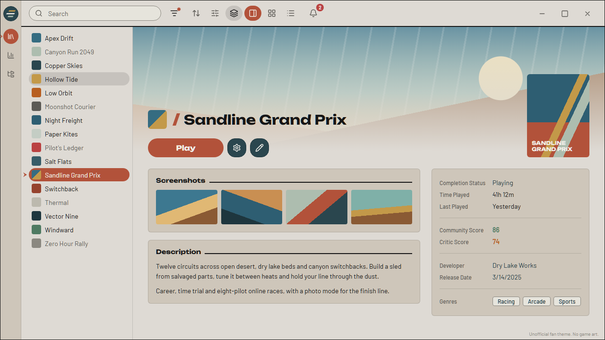</a> | **Slipstream** Galactic Racer inspired. Light paper, racing stripes. _not released yet_ · [More](src/themes/Slipstream/README.md) |
| <a href="src/themes/Rumpus/README.md">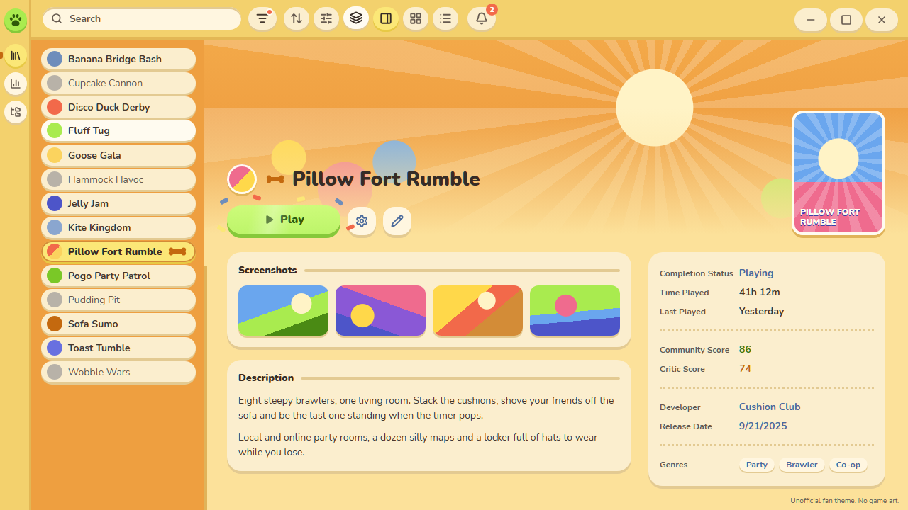</a> | **Rumpus** Party Animals inspired. Light orange, confetti Play. _not released yet_ · [More](src/themes/Rumpus/README.md) |
| <a href="src/themes/GuidingWind/README.md">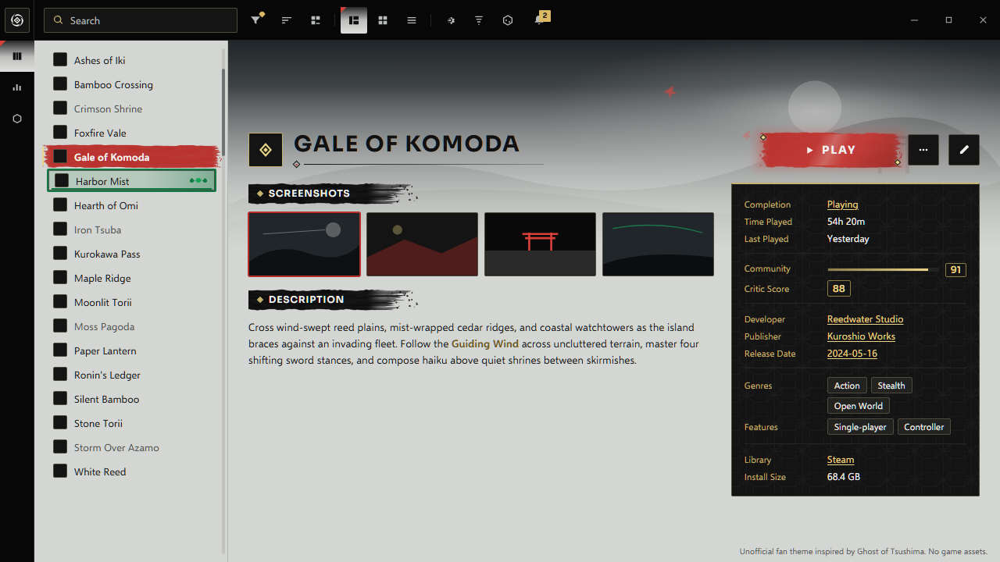</a> | **Guiding Wind** Ghost of Tsushima inspired. Misty washi and sumi ink. _not released yet_ · [More](src/themes/GuidingWind/README.md) |
|  | **Medallion** The Witcher 3 inspired. Stark black, brushed edges. [Download 1.1.0](https://github.com/danitesler/playnite-extensions/releases/tag/medallion-v1.1.0) · [More](src/themes/Medallion/README.md) |
|  | **Shade** shadcn/ui inspired. Zinc gray, soft corners. [Download 1.1.0](https://github.com/danitesler/playnite-extensions/releases/tag/shade-v1.1.0) · [More](src/themes/Shade/README.md) |
|  | **Libertalia** Uncharted 4 inspired. Ivory on black. [Download 1.1.0](https://github.com/danitesler/playnite-extensions/releases/tag/libertalia-v1.1.0) · [More](src/themes/Libertalia/README.md) |
|  | **Night City** Cyberpunk 2077 inspired. Solid yellow, sharp corners. [Download 1.1.0](https://github.com/danitesler/playnite-extensions/releases/tag/nightcity-v1.1.0) · [More](src/themes/NightCity/README.md) |
|  | **Holotape** Fallout inspired. Warm amber terminal. [Download 1.1.0](https://github.com/danitesler/playnite-extensions/releases/tag/holotape-v1.1.0) · [More](src/themes/Holotape/README.md) |
|  | **Blacklist** Most Wanted inspired. Amber and hazard stripes. [Download 1.1.0](https://github.com/danitesler/playnite-extensions/releases/tag/blacklist-v1.1.0) · [More](src/themes/Blacklist/README.md) |
|  | **Tarnish** Elden Ring inspired. Fading olive and gold light. _not released yet_ · [More](src/themes/Tarnish/README.md) |
|  | **Codex** Assassin's Creed inspired. Charcoal and gold. [Download 1.1.0](https://github.com/danitesler/playnite-extensions/releases/tag/codex-v1.1.0) · [More](src/themes/Codex/README.md) |
|  | **Attache** Resident Evil 4 inspired. Near-black and tense. [Download 1.1.0](https://github.com/danitesler/playnite-extensions/releases/tag/attache-v1.1.0) · [More](src/themes/Attache/README.md) |
|  | **Ace** Counter-Strike 1.6 inspired. Olive chrome, amber text. [Download 1.1.0](https://github.com/danitesler/playnite-extensions/releases/tag/ace-v1.1.0) · [More](src/themes/Ace/README.md) |
|  | **Cordon** S.T.A.L.K.E.R. inspired. Rust and lamplight. [Download 1.1.0](https://github.com/danitesler/playnite-extensions/releases/tag/cordon-v1.1.0) · [More](src/themes/Cordon/README.md) |
|  | **Questlog** World of Warcraft inspired. Charcoal and gold. [Download 1.1.0](https://github.com/danitesler/playnite-extensions/releases/tag/questlog-v1.1.0) · [More](src/themes/Questlog/README.md) |
|  | **Hearthside** Hearthstone inspired. Tavern wood and brass. [Download 1.1.0](https://github.com/danitesler/playnite-extensions/releases/tag/hearthside-v1.1.0) · [More](src/themes/Hearthside/README.md) |
| <a href="src/themes/Hallowtide/README.md">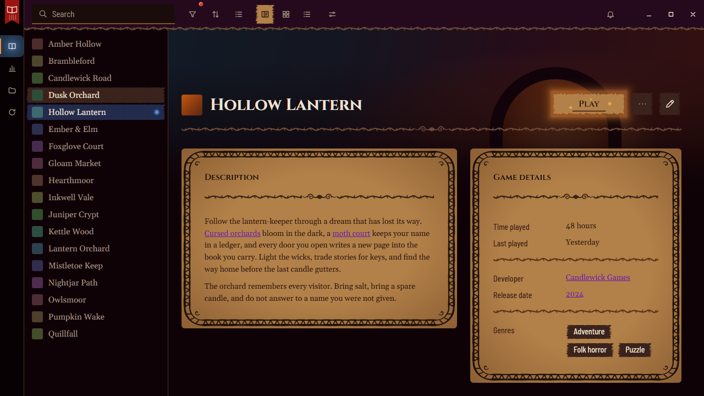</a> | **Hallowtide** All Hallows inspired. Parchment and lantern light. _not released yet_ · [More](src/themes/Hallowtide/README.md) |
| <a href="src/themes/Gumshoe/README.md">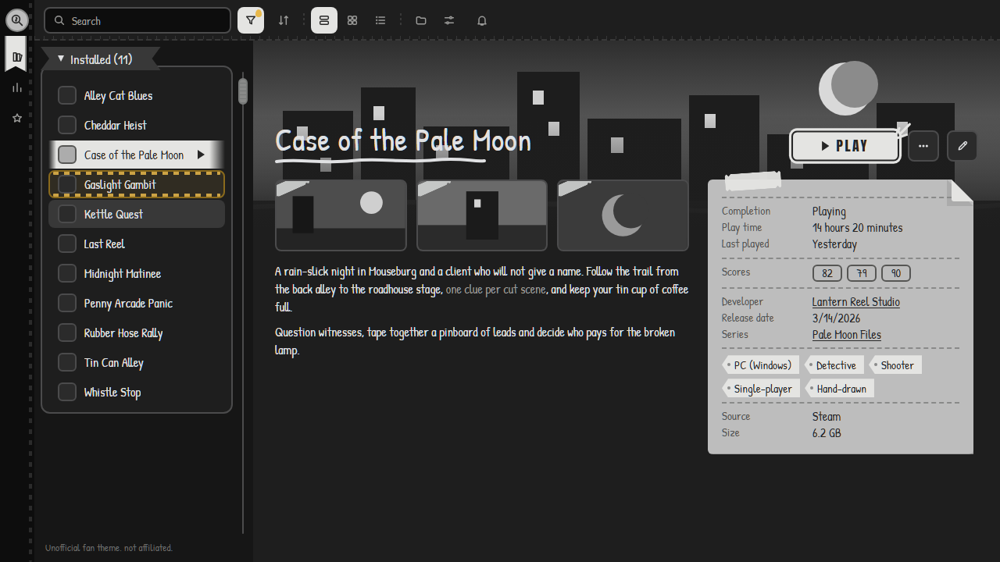</a> | **Gumshoe** Mouse: P.I. inspired. A paper detective desk. _not released yet_ · [More](src/themes/Gumshoe/README.md) |
|  | **Overworld** Minecraft inspired. Blocky stone gray. [Download 1.1.0](https://github.com/danitesler/playnite-extensions/releases/tag/overworld-v1.1.0) · [More](src/themes/Overworld/README.md) |
| <a href="src/themes/Inkbolt/README.md">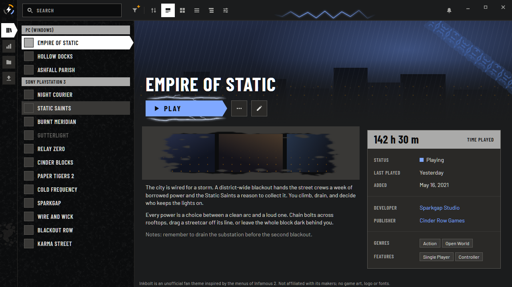</a> | **Inkbolt** Infamous 2 inspired. Grunge ink and a cobalt bolt. _not released yet_ · [More](src/themes/Inkbolt/README.md) |
|  | **Biome** Terraria inspired. Cheerful pixel blues. [Download 1.1.0](https://github.com/danitesler/playnite-extensions/releases/tag/biome-v1.1.0) · [More](src/themes/Biome/README.md) |
|  | **Dropzone** Fortnite inspired. Bright navy and yellow. [Download 1.1.0](https://github.com/danitesler/playnite-extensions/releases/tag/dropzone-v1.1.0) · [More](src/themes/Dropzone/README.md) |
|  | **Cold Seat** Warcraft III inspired. Icy stone and gold. [Download 1.1.0](https://github.com/danitesler/playnite-extensions/releases/tag/coldseat-v1.1.0) · [More](src/themes/ColdSeat/README.md) |
|  | **Primo** GitHub Primer inspired. Dark and tidy. [Download 1.1.0](https://github.com/danitesler/playnite-extensions/releases/tag/primo-v1.1.0) · [More](src/themes/Primo/README.md) |
|  | **Ancient** Dota 2 inspired. Dark slate, cool glow. [Download 1.1.0](https://github.com/danitesler/playnite-extensions/releases/tag/ancient-v1.1.0) · [More](src/themes/Ancient/README.md) |
|  | **Ayywi** ayywi inspired. Black surfaces and pill buttons. [Download 1.1.0](https://github.com/danitesler/playnite-extensions/releases/tag/ayywi-v1.1.0) · [More](src/themes/Ayywi/README.md) |
|  | **Clutch** Counter-Strike 2 inspired. Dark and tactical. [Download 1.1.0](https://github.com/danitesler/playnite-extensions/releases/tag/clutch-v1.1.0) · [More](src/themes/Clutch/README.md) |
|  | **Fluence** Fluent 2 inspired. Soft dark surfaces. [Download 1.1.0](https://github.com/danitesler/playnite-extensions/releases/tag/fluence-v1.1.0) · [More](src/themes/Fluence/README.md) |
| <a href="src/themes/Hexfall/README.md">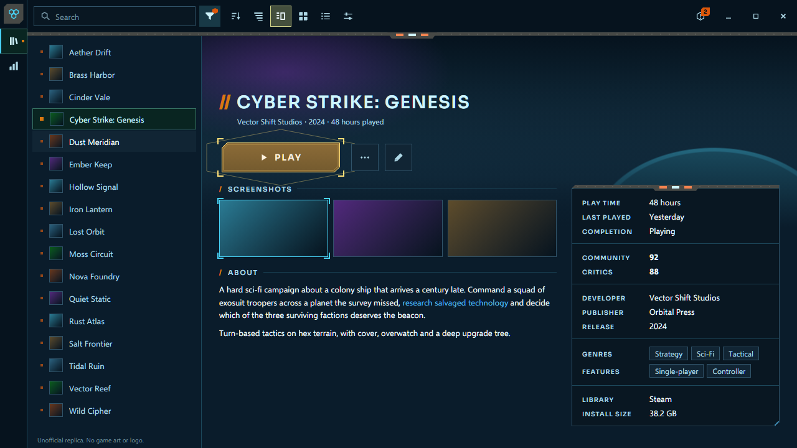</a> | **Hexfall** Planetfall inspired. Navy glass and brass. _not released yet_ · [More](src/themes/Hexfall/README.md) |
| <a href="src/themes/Cloudbank/README.md">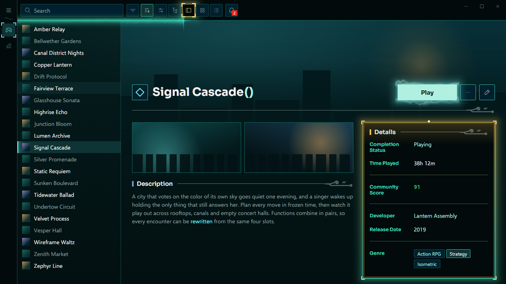</a> | **Cloudbank** Transistor inspired. Teal panels, mint edges. [Download 1.0.0](https://github.com/danitesler/playnite-extensions/releases/tag/cloudbank-v1.0.0) · [More](src/themes/Cloudbank/README.md) |
| <a href="src/themes/GildedRift/README.md">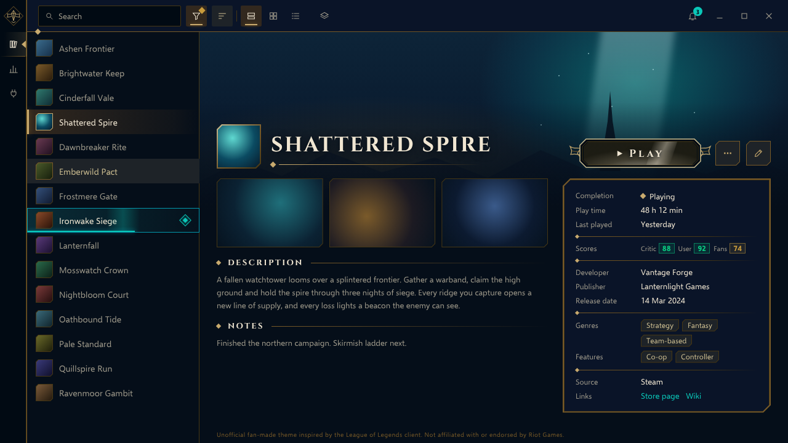</a> | **Gilded Rift** League of Legends inspired. Navy and hextech gold. _not released yet_ · [More](src/themes/GildedRift/README.md) |
|  | **Uplink** StarCraft II inspired. Cold steel and blue glow. [Download 1.1.0](https://github.com/danitesler/playnite-extensions/releases/tag/uplink-v1.1.0) · [More](src/themes/Uplink/README.md) |
|  | **Launchpad** Battle.net inspired. Dark, with a blue glow. [Download 1.1.0](https://github.com/danitesler/playnite-extensions/releases/tag/launchpad-v1.1.0) · [More](src/themes/Launchpad/README.md) |
|  | **Materia** Material Design inspired. Layered dark surfaces. [Download 1.1.0](https://github.com/danitesler/playnite-extensions/releases/tag/materia-v1.1.0) · [More](src/themes/Materia/README.md) |
|  | **Payload** Overwatch 2 inspired. Deep navy and bright. [Download 1.1.0](https://github.com/danitesler/playnite-extensions/releases/tag/payload-v1.1.0) · [More](src/themes/Payload/README.md) |
|  | **Stormrift** Heroes of the Storm inspired. Cosmic indigo and hex rims. _not released yet_ · [More](src/themes/Stormrift/README.md) |
| <a href="src/themes/Backbeat/README.md">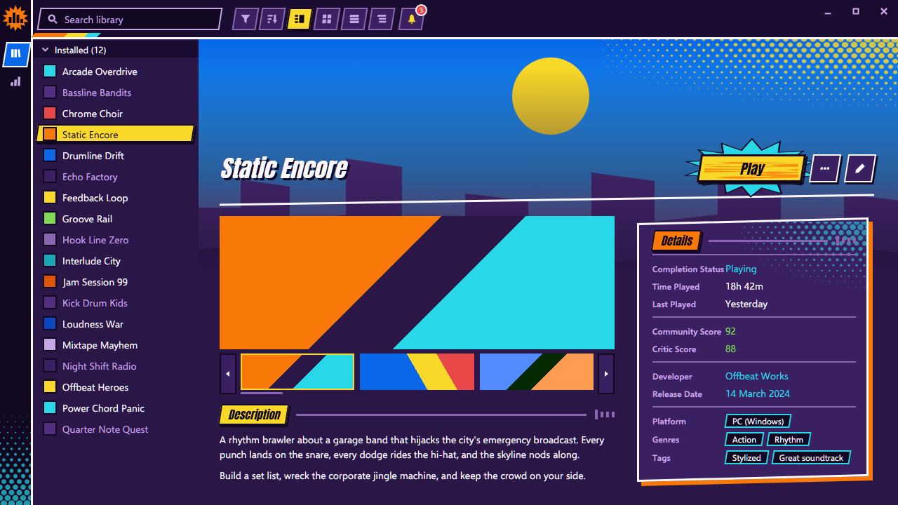</a> | **Backbeat** Hi-Fi RUSH inspired. Comic ink and halftone. [Download 1.0.0](https://github.com/danitesler/playnite-extensions/releases/tag/backbeat-v1.0.0) · [More](src/themes/Backbeat/README.md) |
|  | **Reverie** Dreams inspired. Violet air, gold controls. _not released yet_ · [More](src/themes/Reverie/README.md) |
|  | **Mann Co** Team Fortress 2 inspired. Warm paper and comics. [Download 1.1.0](https://github.com/danitesler/playnite-extensions/releases/tag/mannco-v1.1.0) · [More](src/themes/MannCo/README.md) |
|  | **Emberline** Gears 5 inspired. Black plates, ember frames. _not released yet_ · [More](src/themes/Emberline/README.md) |
|  | **Bloodpetal** Diablo IV inspired. Cut stone and blood red. _not released yet_ · [More](src/themes/Bloodpetal/README.md) |
| <a href="src/themes/Relay/README.md">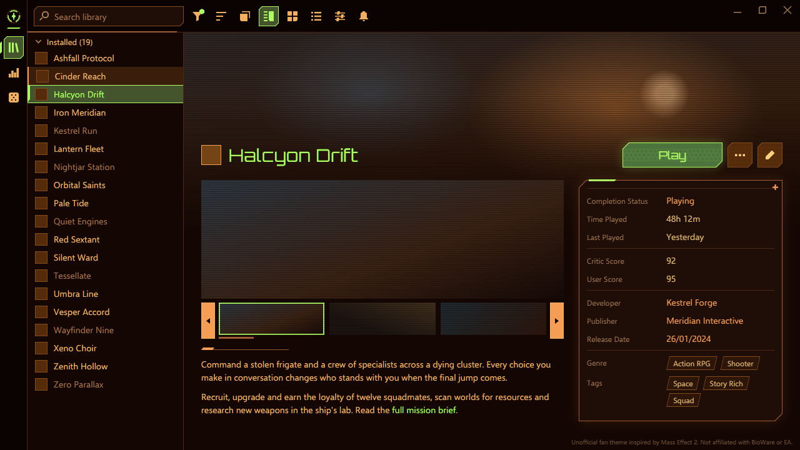</a> | **Relay** Mass Effect 2 inspired. Amber plates and lime. _not released yet_ · [More](src/themes/Relay/README.md) |
|  | **Last Flame** Darkest Dungeon II inspired. Ink and torn gold. [Download 1.0.0](https://github.com/danitesler/playnite-extensions/releases/tag/lastflame-v1.0.0) · [More](src/themes/LastFlame/README.md) |
|  | **Tumbleweed** Red Dead inspired. Dusty maroon on black. [Download 1.1.0](https://github.com/danitesler/playnite-extensions/releases/tag/tumbleweed-v1.1.0) · [More](src/themes/Tumbleweed/README.md) |
|  | **Calling Card** Persona 5 inspired. Ink black and bold red. [Download 1.1.0](https://github.com/danitesler/playnite-extensions/releases/tag/callingcard-v1.1.0) · [More](src/themes/CallingCard/README.md) |
| <a href="src/themes/Glyphbit/README.md">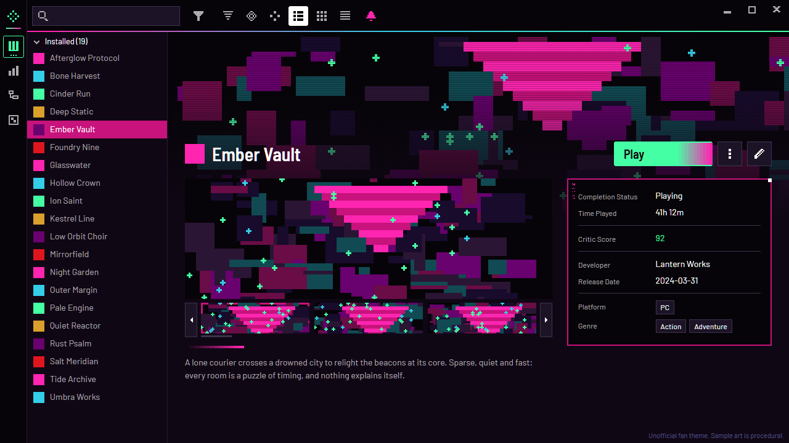</a> | **Glyphbit** Hyper Light Drifter inspired. Pixel neon. [Download 1.0.0](https://github.com/danitesler/playnite-extensions/releases/tag/glyphbit-v1.0.0) · [More](src/themes/Glyphbit/README.md) |
| <a href="src/themes/Visorline/README.md">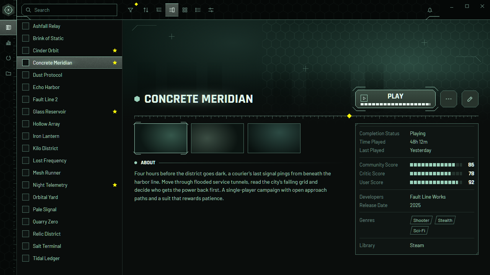</a> | **Visorline** Crysis 2 inspired. Honeycomb and mint ink. _not released yet_ · [More](src/themes/Visorline/README.md) |
|  | **Chakram** Chakra UI inspired. Flat teal surfaces. [Download 1.1.0](https://github.com/danitesler/playnite-extensions/releases/tag/chakram-v1.1.0) · [More](src/themes/Chakram/README.md) |

## Installation

1. **Inside Playnite:** open **Add-ons** from the main menu, browse or search for the extension, and install it from there.
2. **Or from GitHub:** on **[Releases](https://github.com/danitesler/playnite-extensions/releases)**, open the release for the add-on you want, download its `.pext` or `.pthm` file, and open it in **Windows** (double-click or choose **Open**).
3. Click **Install** when Playnite prompts you, then restart Playnite.

## Questions, suggestions, and issues

If you have a question, suggestion, or run into a problem, [open an issue](https://github.com/danitesler/playnite-extensions/issues).
Want to contribute? See [CONTRIBUTING.md](CONTRIBUTING.md) for setup, validation, and PR guidance.

---

Themes inspired by other products are unofficial fan work, not affiliated with or endorsed by their owners. All names and marks belong to them. No third-party logos, game files or proprietary artwork are included.
