# Playnite Extensions

Free, open-source **Playnite** add-ons: small plugins that tidy up the desktop library and **desktop themes**. Each add-on is built and published on its own; pick the ones you want.

I'm a product designer, and these are what I make when I'm not doing that. They're free and will stay free. If they make your library nicer, the best support is a suggestion or bug report on the [issues page](https://github.com/danitesler/playnite-extensions/issues). If you like my work and want to see more, take a look at my [portfolio](https://danitesler.com), or [buy me a coffee on Ko-fi](https://ko-fi.com/danitesler) if you'd like to chip in. Thank you 🙂

## Add-ons

### Plugins

| Icon | Plugin |
| --- | --- |
| <a href="src/Autogrid/README.md">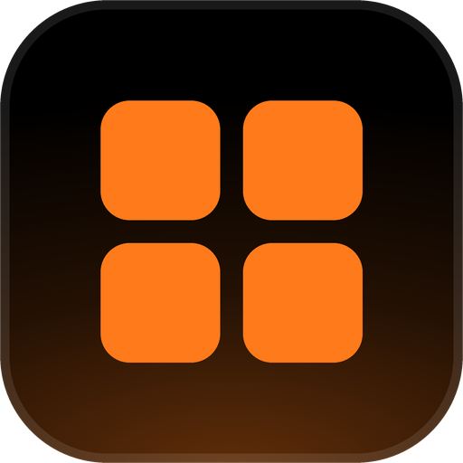</a> | **Autogrid** · [Download 1.2.0](https://github.com/danitesler/playnite-extensions/releases/tag/autogrid-v1.2.0) |
|  | **GameHoverDetails** · [Download 1.1.5](https://github.com/danitesler/playnite-extensions/releases/tag/gamehoverdetails-v1.1.5) |
|  | **AutoStatus** · [Download 1.1.0](https://github.com/danitesler/playnite-extensions/releases/tag/autostatus-v1.1.0) |
|  | **RandomTheme** · [Download 1.0.1](https://github.com/danitesler/playnite-extensions/releases/tag/randomtheme-v1.0.1) |

### Themes

| | |
| :--- | :--- |
| <a href="src/themes/Plumbline/README.md">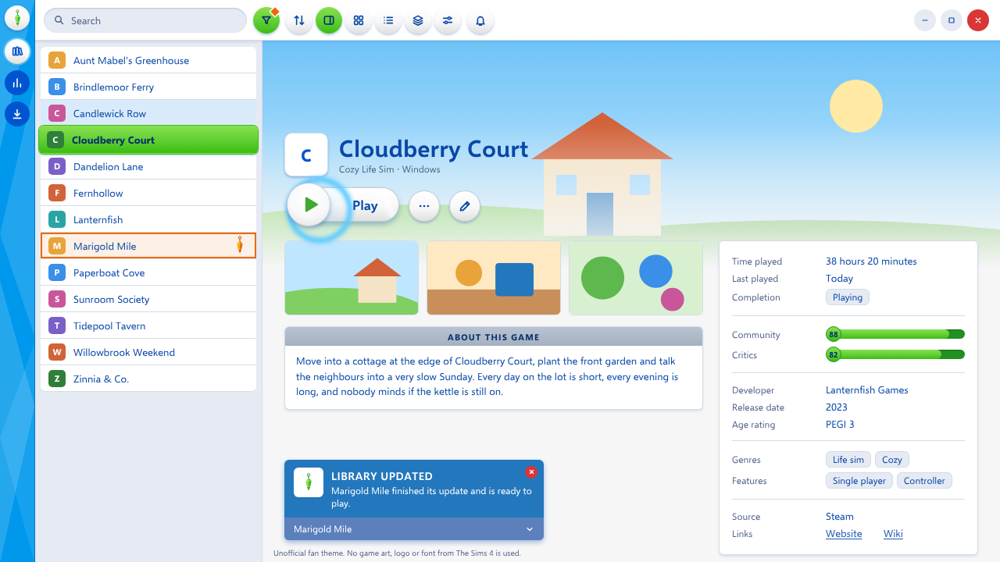</a> [**Plumbline**](src/themes/Plumbline/README.md) · _not released yet_ |  [**Rimewash**](src/themes/Rimewash/README.md) · _not released yet_ |
| <a href="src/themes/Cropmark/README.md">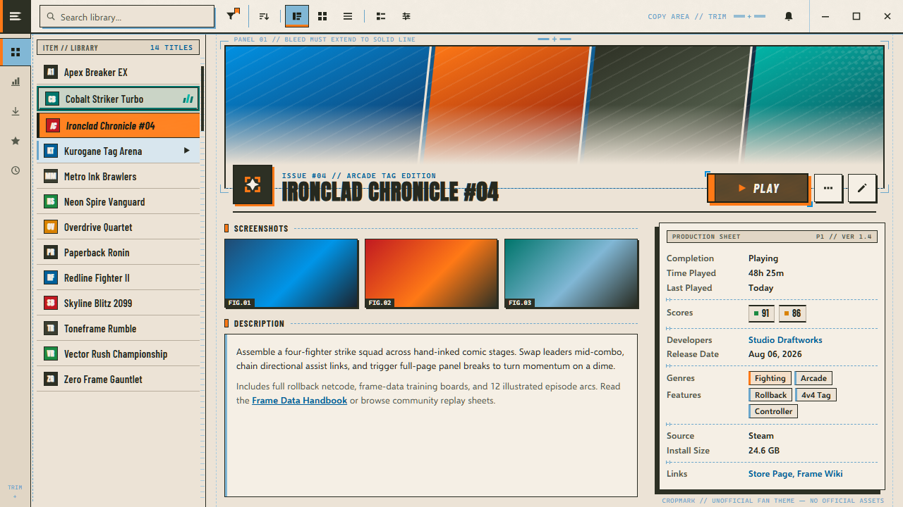</a> [**Cropmark**](src/themes/Cropmark/README.md) · _not released yet_ |  [**Slipstream**](src/themes/Slipstream/README.md) · _not released yet_ |
|  [**Black Box**](src/themes/BlackBox/README.md) · _not released yet_ |  [**Rumpus**](src/themes/Rumpus/README.md) · _not released yet_ |
| <a href="src/themes/Fernscroll/README.md">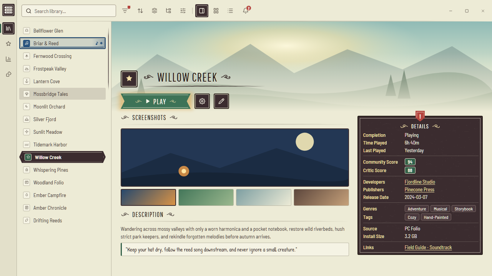</a> [**Fernscroll**](src/themes/Fernscroll/README.md) · _not released yet_ |  [**Guiding Wind**](src/themes/GuidingWind/README.md) · _not released yet_ |
|  [**Medallion**](src/themes/Medallion/README.md) · [Download 1.1.0](https://github.com/danitesler/playnite-extensions/releases/tag/medallion-v1.1.0) |  [**Attache**](src/themes/Attache/README.md) · [Download 1.1.0](https://github.com/danitesler/playnite-extensions/releases/tag/attache-v1.1.0) |
|  [**Codex**](src/themes/Codex/README.md) · [Download 1.1.0](https://github.com/danitesler/playnite-extensions/releases/tag/codex-v1.1.0) | <a href="src/themes/Tarnish/README.md">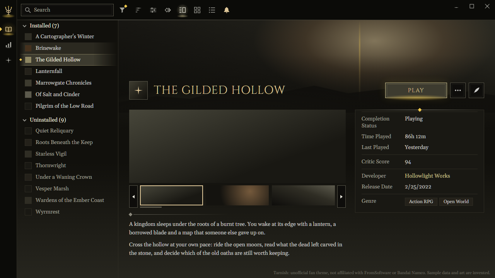</a> [**Tarnish**](src/themes/Tarnish/README.md) · _not released yet_ |
|  [**Cordon**](src/themes/Cordon/README.md) · [Download 1.1.0](https://github.com/danitesler/playnite-extensions/releases/tag/cordon-v1.1.0) |  [**Ace**](src/themes/Ace/README.md) · [Download 1.1.0](https://github.com/danitesler/playnite-extensions/releases/tag/ace-v1.1.0) |
|  [**Blacklist**](src/themes/Blacklist/README.md) · [Download 1.1.0](https://github.com/danitesler/playnite-extensions/releases/tag/blacklist-v1.1.0) |  [**Holotape**](src/themes/Holotape/README.md) · [Download 1.1.0](https://github.com/danitesler/playnite-extensions/releases/tag/holotape-v1.1.0) |
|  [**Night City**](src/themes/NightCity/README.md) · [Download 1.1.0](https://github.com/danitesler/playnite-extensions/releases/tag/nightcity-v1.1.0) |  [**Libertalia**](src/themes/Libertalia/README.md) · [Download 1.1.0](https://github.com/danitesler/playnite-extensions/releases/tag/libertalia-v1.1.0) |
|  [**Shade**](src/themes/Shade/README.md) · [Download 1.1.0](https://github.com/danitesler/playnite-extensions/releases/tag/shade-v1.1.0) |  [**Questlog**](src/themes/Questlog/README.md) · [Download 1.1.0](https://github.com/danitesler/playnite-extensions/releases/tag/questlog-v1.1.0) |
| <a href="src/themes/Whalebone/README.md">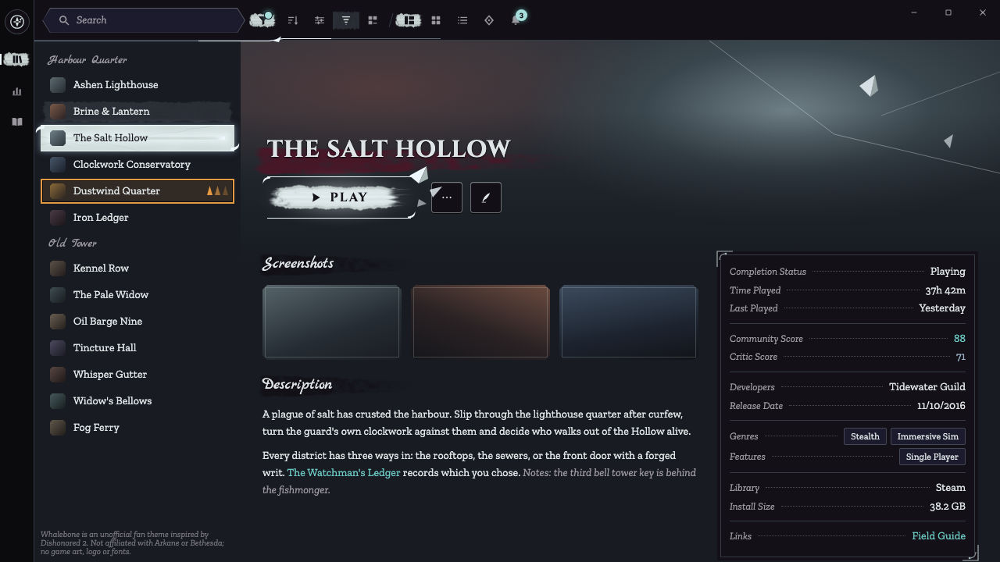</a> [**Whalebone**](src/themes/Whalebone/README.md) · _not released yet_ |  [**Calling Card**](src/themes/CallingCard/README.md) · [Download 1.1.0](https://github.com/danitesler/playnite-extensions/releases/tag/callingcard-v1.1.0) |
| <a href="src/themes/LastFlame/README.md">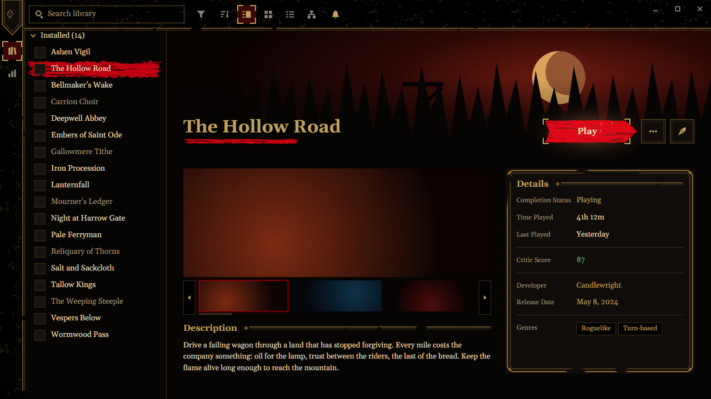</a> [**Last Flame**](src/themes/LastFlame/README.md) · [Download 1.0.0](https://github.com/danitesler/playnite-extensions/releases/tag/lastflame-v1.0.0) |  [**Tumbleweed**](src/themes/Tumbleweed/README.md) · [Download 1.1.0](https://github.com/danitesler/playnite-extensions/releases/tag/tumbleweed-v1.1.0) |
| <a href="src/themes/Bloodpetal/README.md">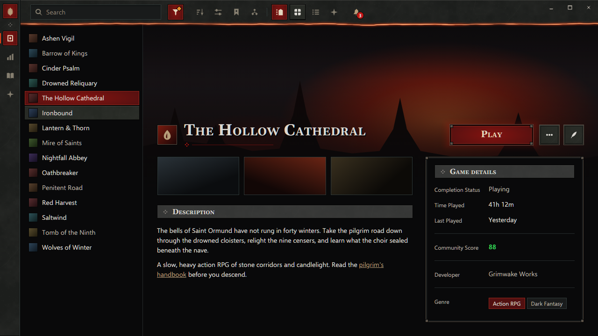</a> [**Bloodpetal**](src/themes/Bloodpetal/README.md) · _not released yet_ |  [**Relay**](src/themes/Relay/README.md) · _not released yet_ |
|  [**Hallowtide**](src/themes/Hallowtide/README.md) · _not released yet_ |  [**Hearthside**](src/themes/Hearthside/README.md) · [Download 1.1.0](https://github.com/danitesler/playnite-extensions/releases/tag/hearthside-v1.1.0) |
|  [**Bathysphere**](src/themes/Bathysphere/README.md) · _not released yet_ |  [**Gumshoe**](src/themes/Gumshoe/README.md) · _not released yet_ |
| <a href="src/themes/Cogplate/README.md">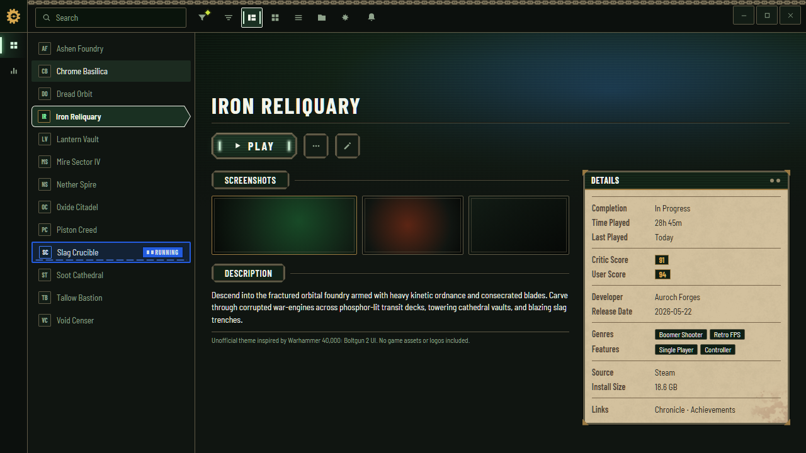</a> [**Cogplate**](src/themes/Cogplate/README.md) · _not released yet_ | <a href="src/themes/Wyldcrown/README.md">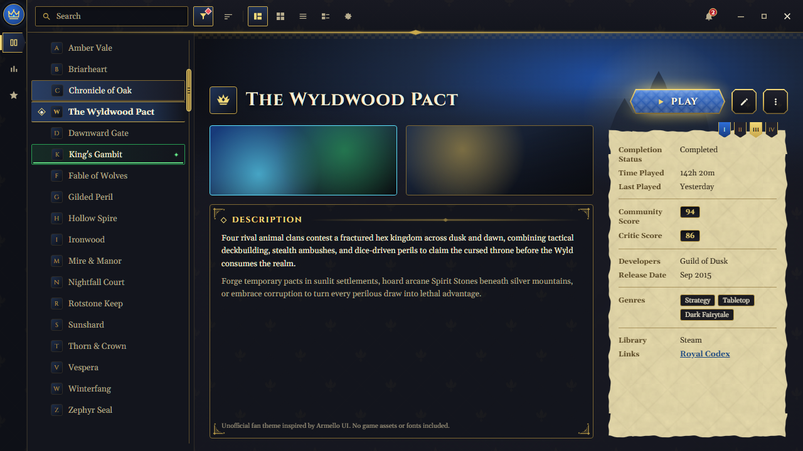</a> [**Wyldcrown**](src/themes/Wyldcrown/README.md) · _not released yet_ |
|  [**Overworld**](src/themes/Overworld/README.md) · [Download 1.1.0](https://github.com/danitesler/playnite-extensions/releases/tag/overworld-v1.1.0) |  [**Inkbolt**](src/themes/Inkbolt/README.md) · _not released yet_ |
|  [**Ayywi**](src/themes/Ayywi/README.md) · [Download 1.1.0](https://github.com/danitesler/playnite-extensions/releases/tag/ayywi-v1.1.0) |  [**Ancient**](src/themes/Ancient/README.md) · [Download 1.1.0](https://github.com/danitesler/playnite-extensions/releases/tag/ancient-v1.1.0) |
|  [**Primo**](src/themes/Primo/README.md) · [Download 1.1.0](https://github.com/danitesler/playnite-extensions/releases/tag/primo-v1.1.0) |  [**Cold Seat**](src/themes/ColdSeat/README.md) · [Download 1.1.0](https://github.com/danitesler/playnite-extensions/releases/tag/coldseat-v1.1.0) |
|  [**Uplink**](src/themes/Uplink/README.md) · [Download 1.1.0](https://github.com/danitesler/playnite-extensions/releases/tag/uplink-v1.1.0) | <a href="src/themes/Stormrift/README.md">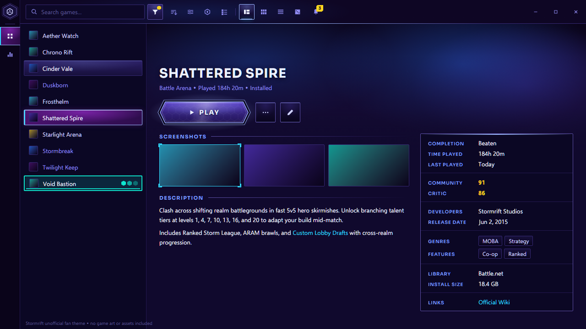</a> [**Stormrift**](src/themes/Stormrift/README.md) · _not released yet_ |
| <a href="src/themes/Vesperglass/README.md">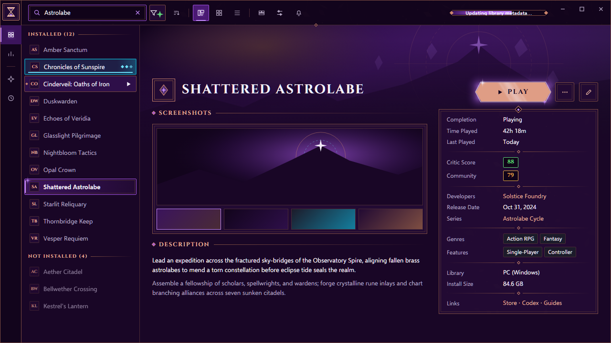</a> [**Vesperglass**](src/themes/Vesperglass/README.md) · _not released yet_ |  [**Glyphbit**](src/themes/Glyphbit/README.md) · [Download 1.0.0](https://github.com/danitesler/playnite-extensions/releases/tag/glyphbit-v1.0.0) |
|  [**Visorline**](src/themes/Visorline/README.md) · _not released yet_ |  [**Chakram**](src/themes/Chakram/README.md) · [Download 1.1.0](https://github.com/danitesler/playnite-extensions/releases/tag/chakram-v1.1.0) |
|  [**Clutch**](src/themes/Clutch/README.md) · [Download 1.1.0](https://github.com/danitesler/playnite-extensions/releases/tag/clutch-v1.1.0) |  [**Runeskald**](src/themes/Runeskald/README.md) · _not released yet_ |
|  [**Fluence**](src/themes/Fluence/README.md) · [Download 1.1.0](https://github.com/danitesler/playnite-extensions/releases/tag/fluence-v1.1.0) | <a href="src/themes/Studlock/README.md">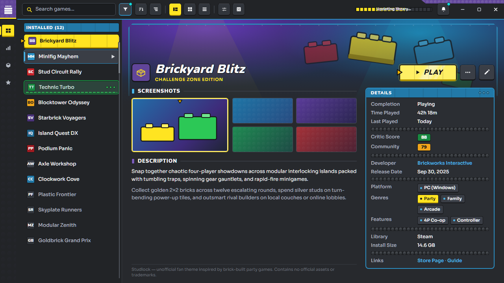</a> [**Studlock**](src/themes/Studlock/README.md) · _not released yet_ |
|  [**Backbeat**](src/themes/Backbeat/README.md) · [Download 1.0.0](https://github.com/danitesler/playnite-extensions/releases/tag/backbeat-v1.0.0) | <a href="src/themes/Reverie/README.md">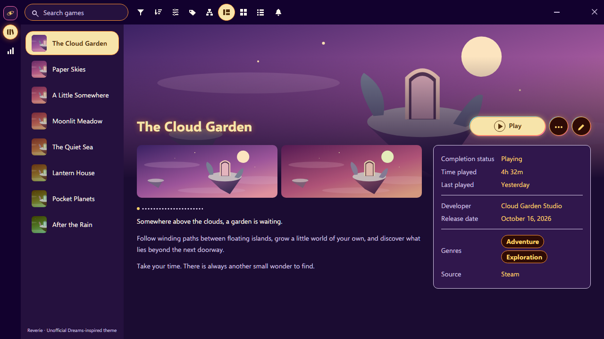</a> [**Reverie**](src/themes/Reverie/README.md) · _not released yet_ |
| <a href="src/themes/ViceDusk/README.md">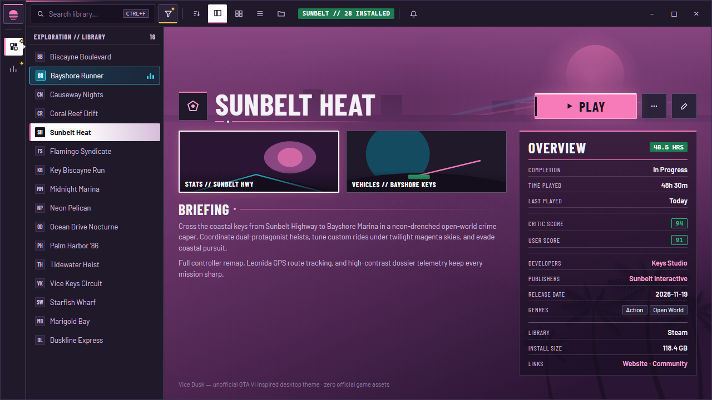</a> [**Vice Dusk**](src/themes/ViceDusk/README.md) · _not released yet_ |  [**Mann Co**](src/themes/MannCo/README.md) · [Download 1.1.0](https://github.com/danitesler/playnite-extensions/releases/tag/mannco-v1.1.0) |
| <a href="src/themes/Verst/README.md">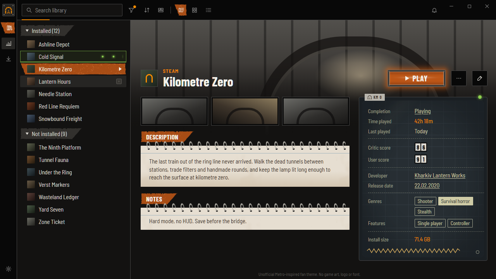</a> [**Verst**](src/themes/Verst/README.md) · _not released yet_ | <a href="src/themes/Emberline/README.md">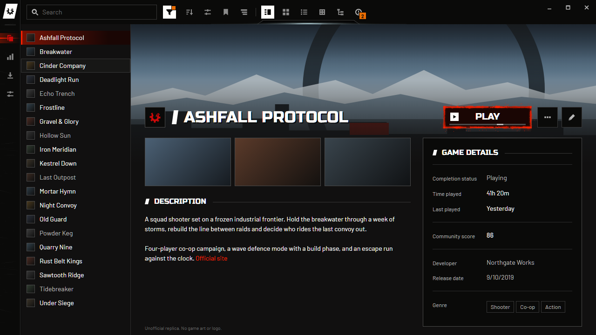</a> [**Emberline**](src/themes/Emberline/README.md) · _not released yet_ |
| <a href="src/themes/Ironward/README.md">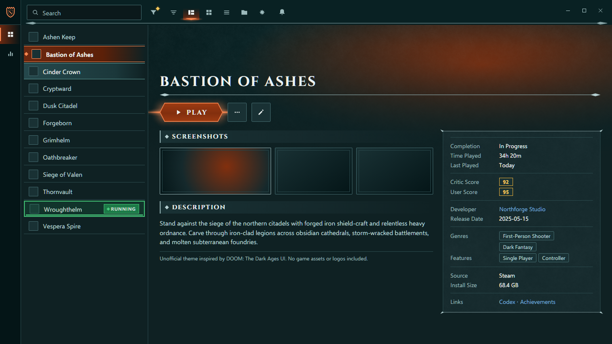</a> [**Ironward**](src/themes/Ironward/README.md) · _not released yet_ |  [**Cloudbank**](src/themes/Cloudbank/README.md) · [Download 1.0.0](https://github.com/danitesler/playnite-extensions/releases/tag/cloudbank-v1.0.0) |
|  [**Hexfall**](src/themes/Hexfall/README.md) · _not released yet_ |  [**Gilded Rift**](src/themes/GildedRift/README.md) · _not released yet_ |
|  [**Launchpad**](src/themes/Launchpad/README.md) · [Download 1.1.0](https://github.com/danitesler/playnite-extensions/releases/tag/launchpad-v1.1.0) |  [**Materia**](src/themes/Materia/README.md) · [Download 1.1.0](https://github.com/danitesler/playnite-extensions/releases/tag/materia-v1.1.0) |
|  [**Payload**](src/themes/Payload/README.md) · [Download 1.1.0](https://github.com/danitesler/playnite-extensions/releases/tag/payload-v1.1.0) |  [**Dropzone**](src/themes/Dropzone/README.md) · [Download 1.1.0](https://github.com/danitesler/playnite-extensions/releases/tag/dropzone-v1.1.0) |
|  [**Biome**](src/themes/Biome/README.md) · [Download 1.1.0](https://github.com/danitesler/playnite-extensions/releases/tag/biome-v1.1.0) |

## Installation

1. **Inside Playnite:** open **Add-ons** from the main menu, browse or search for the extension, and install it from there.
2. **Or from GitHub:** on **[Releases](https://github.com/danitesler/playnite-extensions/releases)**, open the release for the add-on you want, download its `.pext` or `.pthm` file, and open it in **Windows** (double-click or choose **Open**).
3. Click **Install** when Playnite prompts you, then restart Playnite.

## Questions, suggestions, and issues

If you have a question, suggestion, or run into a problem, [open an issue](https://github.com/danitesler/playnite-extensions/issues).
Want to contribute? See [CONTRIBUTING.md](CONTRIBUTING.md) for setup, validation, and PR guidance.

---

Themes inspired by other products are unofficial fan work, not affiliated with or endorsed by their owners. All names and marks belong to them. No third-party logos, game files or proprietary artwork are included.
