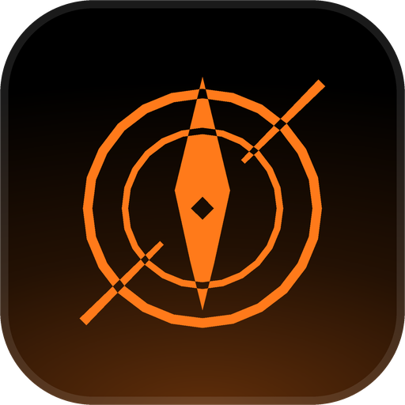
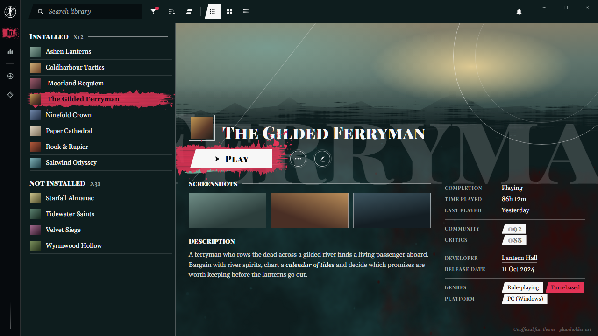
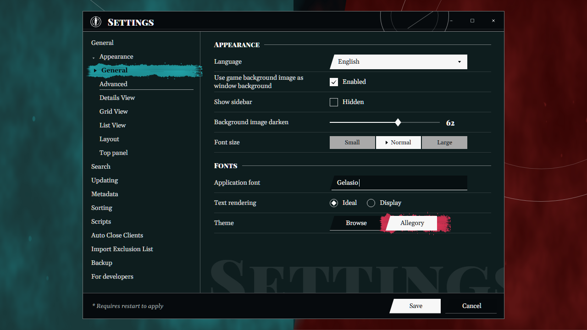

<!-- Generated by scripts/generate-readmes.mjs from info/*.yaml and git tags. Edit those, then re-run it; do not edit this file by hand. -->

# Allegory

**Unofficial Metaphor: ReFantazio-inspired theme: painted teal grounds, Didone small caps, crimson dry-brush selection.**

_Not released yet._

## Screenshots

## About

An unofficial, fan-made Playnite desktop theme inspired by the menus of Metaphor: ReFantazio. Not affiliated with or endorsed by the game's developer or publisher.

Hairline-ruled lists sit on a painted teal ground; the current game, menu row and tab sweep in on a ragged crimson dry brush with ink text. Headings are wide Didone small caps, the game's name rises behind its page as a giant cropped title, Play is a slanted white prompt plate that lands on a crimson splash, and More, Edit, close and cover buttons are ring prompts. Settings get a teal brush, a compass-ring title band and the menus' doubled hairlines; a running game turns quest yellow with a turning compass needle.

Playfair Display SC and Gelasio are bundled (SIL Open Font License). No game art, logo or fonts are included.

## Install

1. **Inside Playnite:** open **Add-ons** from the main menu, browse or search for **Allegory**, and install it from there.
2. **Or from GitHub:** download the `.pthm` file from the release page (see Download above) and open it in **Windows** (double-click it or drag it onto Playnite).
3. Click **Install** when Playnite prompts you, then restart Playnite.
4. Pick the theme in **Settings → Appearance → General → Theme** (Desktop mode), then restart Playnite if it asks.

## Details

- **Type:** Theme (Desktop mode)
- **Latest release:** not released yet
- **Playnite theme API:** 2.9.0
- **Tags:** Dark, Desktop, Gaming, Red
- **Source:** [src/themes/Allegory](https://github.com/danitesler/playnite-extensions/tree/main/src/themes/Allegory)
- **Issues and suggestions:** [GitHub issues](https://github.com/danitesler/playnite-extensions/issues)

## Notices and licenses

- [LICENSE-Playnite.txt](info/LICENSE-Playnite.txt)
- [NOTICE-Allegory.txt](info/NOTICE-Allegory.txt)

---

[← All add-ons](../../../README.md)
