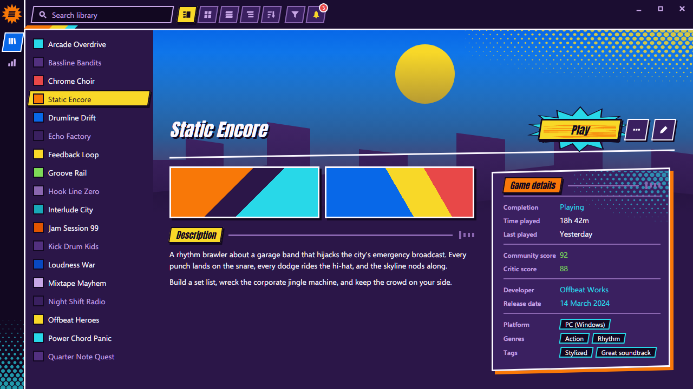
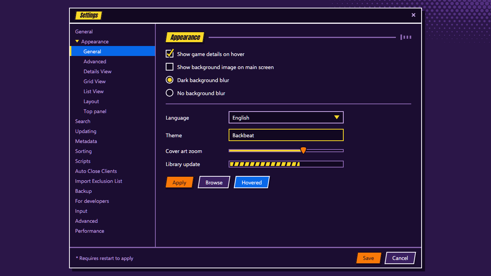

<!-- Generated by scripts/generate-readmes.mjs from info/*.yaml and git tags. Edit those, then re-run it; do not edit this file by hand. -->

# Backbeat

**Hi-Fi RUSH inspired comic-book theme: thick outlines, angled cards, halftone dots and sticker indicators. Unofficial.**

_Not released yet._

## Screenshots

## About

A loud comic-book theme inspired by the cel-shaded look of Hi-Fi RUSH: thick outlines, angled cards, halftone dots, sticker indicators and illustrated controls such as a guitar-pick slider. The Play button thumps on the beat when you hover it.

Unofficial fan theme. Not affiliated with, endorsed by or sponsored by Tango Gameworks, Bethesda Softworks, ZeniMax Media or KRAFTON, Inc. Contains no game art, characters, logos or fonts.

## Install

1. **Inside Playnite:** open **Add-ons** from the main menu, browse or search for **Backbeat**, and install it from there.
2. **Or from GitHub:** download the `.pthm` file from the release page (see Download above) and open it in **Windows** (double-click it or drag it onto Playnite).
3. Click **Install** when Playnite prompts you, then restart Playnite.
4. Pick the theme in **Settings → Appearance → General → Theme** (Desktop mode), then restart Playnite if it asks.

## Details

- **Type:** Theme (Desktop mode)
- **Latest release:** not released yet
- **Playnite theme API:** 2.9.0
- **Tags:** Dark, Desktop
- **Source:** [src/themes/Backbeat](https://github.com/danitesler/playnite-extensions/tree/main/src/themes/Backbeat)
- **Issues and suggestions:** [GitHub issues](https://github.com/danitesler/playnite-extensions/issues)

## Notices and licenses

- [LICENSE-Playnite.txt](info/LICENSE-Playnite.txt)
- [NOTICE-Backbeat.txt](info/NOTICE-Backbeat.txt)

---

[← All add-ons](../../../README.md)
