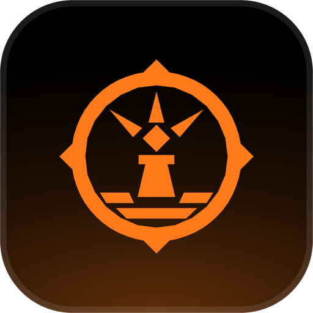
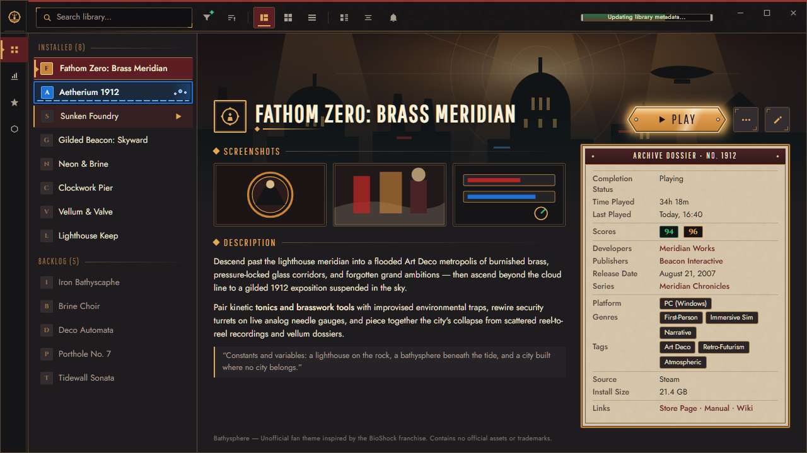
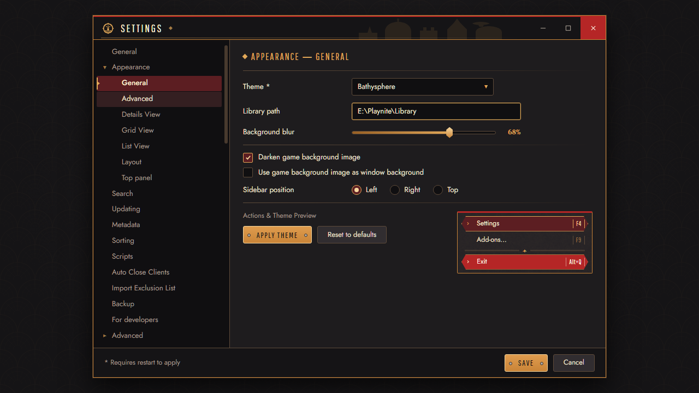

<!-- Generated by scripts/generate-readmes.mjs from info/*.yaml and git tags. Edit those, then re-run it; do not edit this file by hand. -->

# Bathysphere

**Unofficial fan theme inspired by the submerged Art Deco brass of Rapture and the gilded 1912 vellum of Columbia across the BioShock franchise.**

_Not released yet._

## Screenshots

## About

Bathysphere is a dark Playnite Desktop theme inspired by the submerged 1950s Art Deco brass of Rapture and the gilded 1912 Beaux-Arts vellum dossiers of Columbia across the BioShock franchise (BioShock, BioShock 2, and BioShock Infinite).

Features pointed-hexagonal riveted brass CTAs, deep Atlantic verdigris selection plates, a Columbia vellum archive dossier with engraved score seals, EVE/Salts cobalt launching and running indicators with a 12-segment Salts bar and rising bubbles, BioShock 2 hacking-needle sliders, silver-capped glass-tube progress bars, stepped-corner Deco popup menus, and a riveted Bathysphere porthole empty state.

Unofficial fan theme; not affiliated with or endorsed by 2K Games, Take-Two Interactive, Irrational Games, or Cloud Chamber. Contains no official game assets, logos, or proprietary fonts.

## Install

1. **Inside Playnite:** open **Add-ons** from the main menu, browse or search for **Bathysphere**, and install it from there.
2. **Or from GitHub:** download the `.pthm` file from the release page (see Download above) and open it in **Windows** (double-click it or drag it onto Playnite).
3. Click **Install** when Playnite prompts you, then restart Playnite.
4. Pick the theme in **Settings → Appearance → General → Theme** (Desktop mode), then restart Playnite if it asks.

## Details

- **Type:** Theme (Desktop mode)
- **Latest release:** not released yet
- **Playnite theme API:** 2.9.0
- **Tags:** Dark, Desktop
- **Source:** [src/themes/Bathysphere](https://github.com/danitesler/playnite-extensions/tree/main/src/themes/Bathysphere)
- **Issues and suggestions:** [GitHub issues](https://github.com/danitesler/playnite-extensions/issues)

## Notices and licenses

- [LICENSE-Playnite.txt](info/LICENSE-Playnite.txt)
- [NOTICE-Bathysphere.txt](info/NOTICE-Bathysphere.txt)

---

[← All add-ons](../../../README.md)
