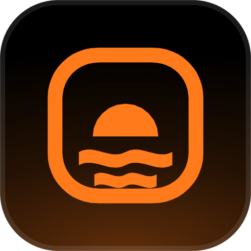
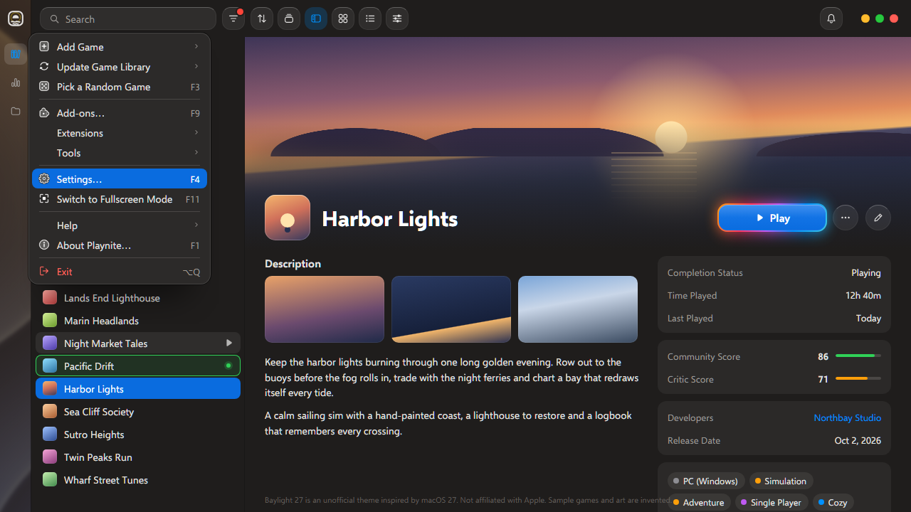
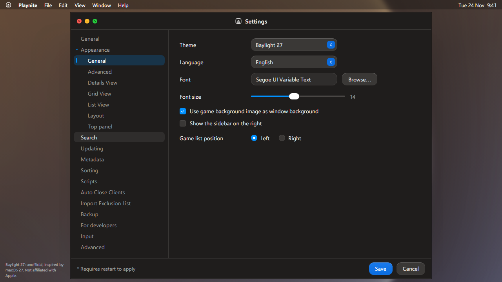

<!-- Generated by scripts/generate-readmes.mjs from info/*.yaml and git tags. Edit those, then re-run it; do not edit this file by hand. -->

# Baylight 27

**Unofficial macOS 27-inspired dark theme: Liquid Glass toolbars, traffic lights, a bronze desktop picture behind the sidebar.**

_Not released yet._

## Screenshots

## About

An unofficial Playnite desktop theme inspired by macOS 27 in its Dark appearance. Not affiliated with or endorsed by Apple.

Playnite becomes a Mac app window: an edge-to-edge sidebar tinted by a bronze silk desktop picture, a uniform toolbar of Liquid Glass buttons, traffic-light window controls, blue table selection and System Settings grouped sections for the game details. Play is a glass button that lights the multicolour Siri glow on hover; covers magnify like icons in the Dock, and a launching game bounces its Dock dot. Menus, pop-up buttons, the segmented tab control, checkboxes and the capsule slider knob follow the Mac's own controls.

No Apple fonts, symbols, wallpapers or logos are included: the icons, the mark and the desktop picture are drawn for this theme, and text uses Segoe UI Variable (Segoe UI on Windows 10).

## Install

1. **Inside Playnite:** open **Add-ons** from the main menu, browse or search for **Baylight 27**, and install it from there.
2. **Or from GitHub:** download the `.pthm` file from the release page (see Download above) and open it in **Windows** (double-click it or drag it onto Playnite).
3. Click **Install** when Playnite prompts you, then restart Playnite.
4. Pick the theme in **Settings → Appearance → General → Theme** (Desktop mode), then restart Playnite if it asks.

## Details

- **Type:** Theme (Desktop mode)
- **Latest release:** not released yet
- **Playnite theme API:** 2.9.0
- **Tags:** Dark, Desktop, Glass, macOS
- **Source:** [src/themes/Baylight](https://github.com/danitesler/playnite-extensions/tree/main/src/themes/Baylight)
- **Issues and suggestions:** [GitHub issues](https://github.com/danitesler/playnite-extensions/issues)

## Notices and licenses

- [LICENSE-Playnite.txt](info/LICENSE-Playnite.txt)
- [NOTICE-Baylight.txt](info/NOTICE-Baylight.txt)

---

[← All add-ons](../../../README.md)
