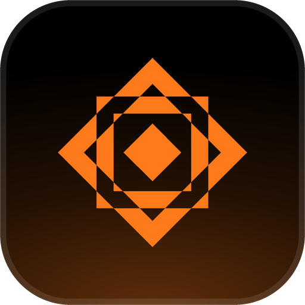
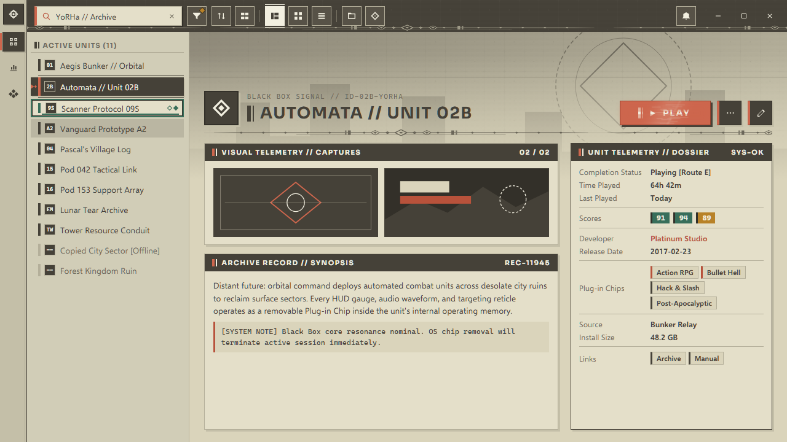
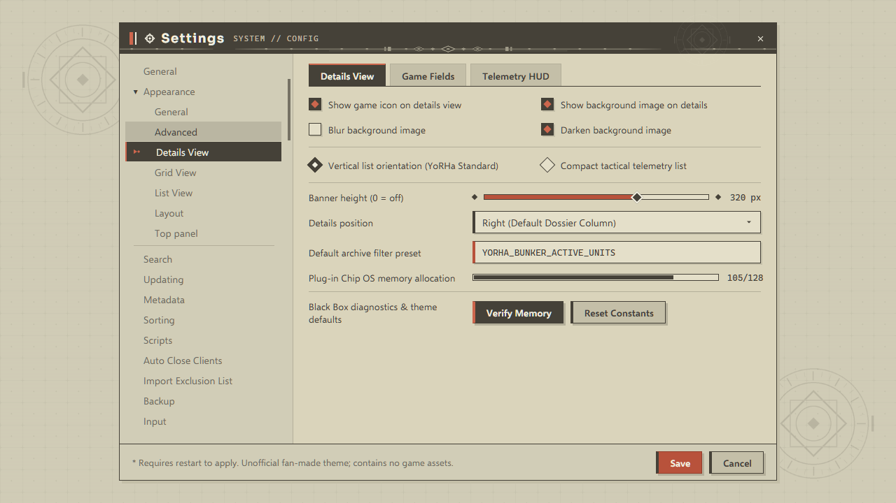

<!-- Generated by scripts/generate-readmes.mjs from info/*.yaml and git tags. Edit those, then re-run it; do not edit this file by hand. -->

# Black Box

**Unofficial NieR:Automata-inspired light Playnite desktop theme: warm khaki parchment, inverted charcoal-olive slabs, musical double-bars, diamond friezes, and terracotta rust alerts.**

_Not released yet._

## Screenshots

## About

A light Playnite desktop theme inspired by the YoRHa operating system UI and HUD of NieR:Automata: warm khaki-parchment telemetry sheets, inverted charcoal-olive selection slabs with top/bottom tracking rails and mechanical pointer cursors, musical-staff double-bar headers, diamond-and-dot borders, Plug-in Chip capacity gauges, and terracotta rust primary actions. Unofficial and fan-made; not affiliated with, endorsed by, or sponsored by Square Enix or PlatinumGames. Contains no game art, logos, or proprietary fonts.

## Install

1. **Inside Playnite:** open **Add-ons** from the main menu, browse or search for **Black Box**, and install it from there.
2. **Or from GitHub:** download the `.pthm` file from the release page (see Download above) and open it in **Windows** (double-click it or drag it onto Playnite).
3. Click **Install** when Playnite prompts you, then restart Playnite.
4. Pick the theme in **Settings → Appearance → General → Theme** (Desktop mode), then restart Playnite if it asks.

## Details

- **Type:** Theme (Desktop mode)
- **Latest release:** not released yet
- **Playnite theme API:** 2.9.0
- **Tags:** Light, Desktop
- **Source:** [src/themes/BlackBox](https://github.com/danitesler/playnite-extensions/tree/main/src/themes/BlackBox)
- **Issues and suggestions:** [GitHub issues](https://github.com/danitesler/playnite-extensions/issues)

## Notices and licenses

- [LICENSE-Playnite.txt](info/LICENSE-Playnite.txt)
- [NOTICE-BlackBox.txt](info/NOTICE-BlackBox.txt)

---

[← All add-ons](../../../README.md)
