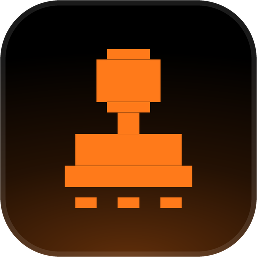
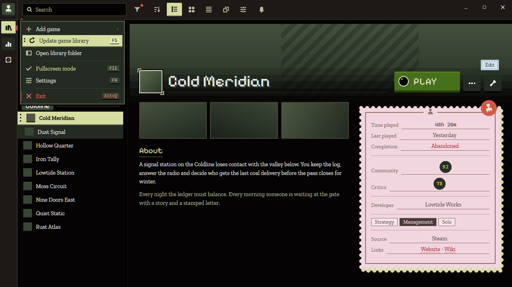
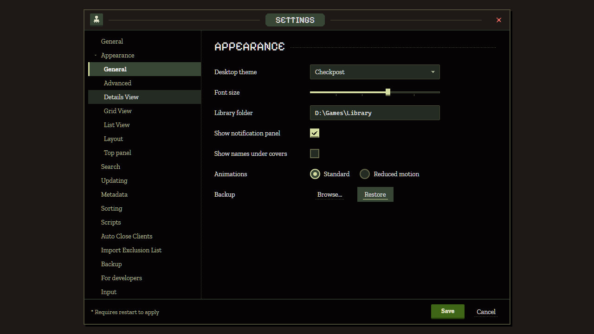

<!-- Generated by scripts/generate-readmes.mjs from info/*.yaml and git tags. Edit those, then re-run it; do not edit this file by hand. -->

# Checkpost

**Unofficial Papers, Please-inspired theme: black void, olive report plates, a rubber-stamp Play button and a pink permit sheet for the details.**

_Not released yet._

## Screenshots

## About

An unofficial, fan-made Playnite desktop theme inspired by the interface of Papers, Please. Not affiliated with or endorsed by the game's creator or publisher.

Black report screens, flat olive plates and cream text. Play is a rubber stamp with a black knob that lifts on hover and slams on press, selected rows are lime paper slips with punched dots, covers are framed like a highlighted document, and menus, tabs and buttons use the game's dotted-underline words and DAY tabs. The game's details sit on a pink permit sheet with a scalloped edge, a taupe inner border, fields standing on underlines and round seal scores. A running game turns amber with three typewriter dots; the empty page is the Official Bulletin.

Zilla Slab and Pixelify Sans are bundled (SIL Open Font License). No game art, logo, seal, document or font is included.

## Install

1. **Inside Playnite:** open **Add-ons** from the main menu, browse or search for **Checkpost**, and install it from there.
2. **Or from GitHub:** download the `.pthm` file from the release page (see Download above) and open it in **Windows** (double-click it or drag it onto Playnite).
3. Click **Install** when Playnite prompts you, then restart Playnite.
4. Pick the theme in **Settings → Appearance → General → Theme** (Desktop mode), then restart Playnite if it asks.

## Details

- **Type:** Theme (Desktop mode)
- **Latest release:** not released yet
- **Playnite theme API:** 2.9.0
- **Tags:** Dark, Desktop, Gaming, Green
- **Source:** [src/themes/Checkpost](https://github.com/danitesler/playnite-extensions/tree/main/src/themes/Checkpost)
- **Issues and suggestions:** [GitHub issues](https://github.com/danitesler/playnite-extensions/issues)

## Notices and licenses

- [LICENSE-Playnite.txt](info/LICENSE-Playnite.txt)
- [NOTICE-Checkpost.txt](info/NOTICE-Checkpost.txt)

---

[← All add-ons](../../../README.md)
