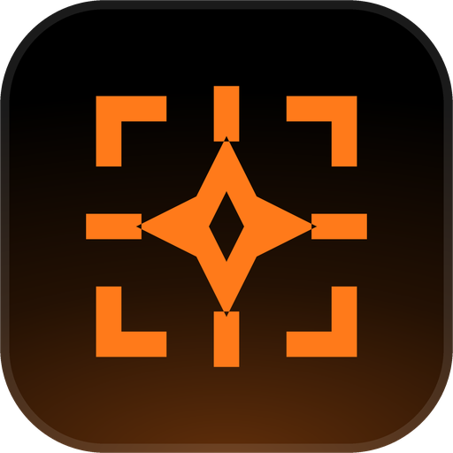
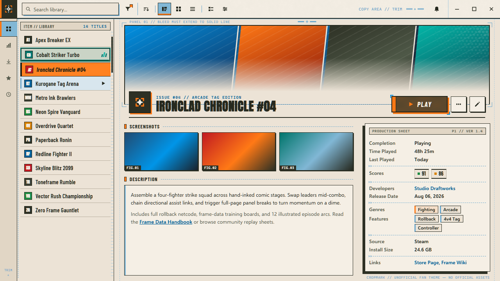
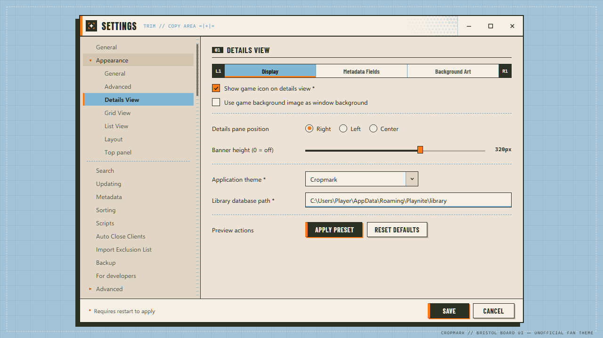

<!-- Generated by scripts/generate-readmes.mjs from info/*.yaml and git tags. Edit those, then re-run it; do not edit this file by hand. -->

# Cropmark

**Unofficial fan theme inspired by the Bristol illustration board, non-photo blue crop marks, sumi-olive ink panels, and comic-marker orange accents of Marvel Tokon: Fighting Souls.**

_Not released yet._

## Screenshots

## About

Cropmark is a light Playnite Desktop theme inspired by the comic-production Bristol illustration board, non-photo blue trim and registration marks, warm sumi-olive charcoal ink frames, and textured comic-marker orange highlights of Marvel Tokon: Fighting Souls.

Features a charcoal-and-orange drop-block Play slab with diagonal marker sheen and expanding non-photo blue corner cropmarks, textured Marker Orange italic library row selection, sharp inked cover tiles with P1 orange corner locks and 52x52 comic-stamp hover buttons, perforated tear-off Bristol notepad popup menus and dropdowns with monochrome key-prompt pills, OPTIONS-style sky-blue active tabs and bottom-edge sliders, a charcoal-backed Bristol production ledger metadata pane with dashed non-photo blue fold breaks (supporting Left, Center, Stretch, and Right positions), Punish! Teal launching and running indicators with 3 skewed spark bars, a notched orange filter bookmark pip, light-theme window-background ink flipping, and a breathing Bristol drafting board empty game page.

Unofficial fan theme; not affiliated with or endorsed by Marvel, Arc System Works Co., Ltd., or Sony Interactive Entertainment Inc. Contains no official game assets, logos, trademarks, or proprietary fonts.

## Install

1. **Inside Playnite:** open **Add-ons** from the main menu, browse or search for **Cropmark**, and install it from there.
2. **Or from GitHub:** download the `.pthm` file from the release page (see Download above) and open it in **Windows** (double-click it or drag it onto Playnite).
3. Click **Install** when Playnite prompts you, then restart Playnite.
4. Pick the theme in **Settings → Appearance → General → Theme** (Desktop mode), then restart Playnite if it asks.

## Details

- **Type:** Theme (Desktop mode)
- **Latest release:** not released yet
- **Playnite theme API:** 2.9.0
- **Tags:** Light, Desktop
- **Source:** [src/themes/Cropmark](https://github.com/danitesler/playnite-extensions/tree/main/src/themes/Cropmark)
- **Issues and suggestions:** [GitHub issues](https://github.com/danitesler/playnite-extensions/issues)

## Notices and licenses

- [LICENSE-Playnite.txt](info/LICENSE-Playnite.txt)
- [NOTICE-Cropmark.txt](info/NOTICE-Cropmark.txt)

---

[← All add-ons](../../../README.md)
