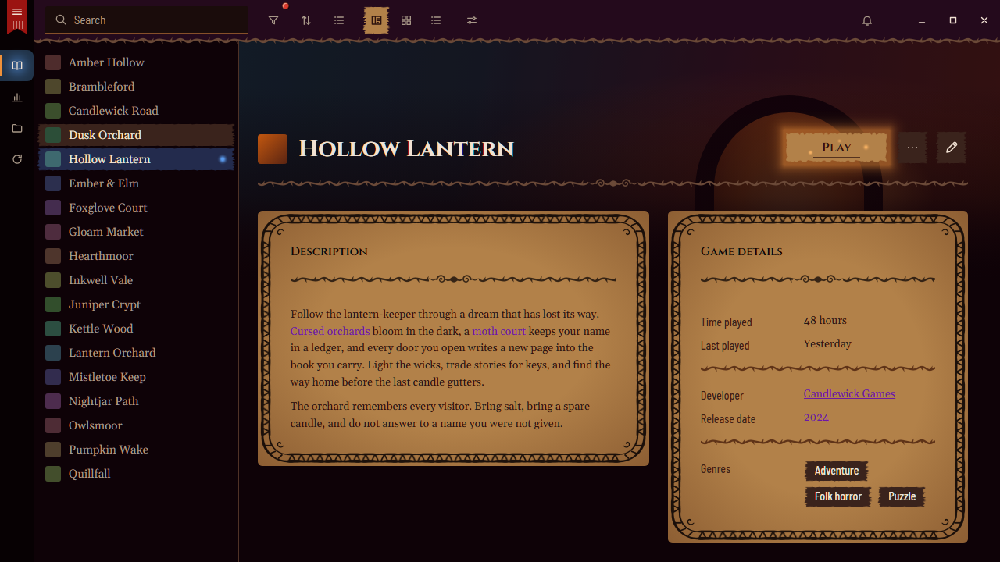
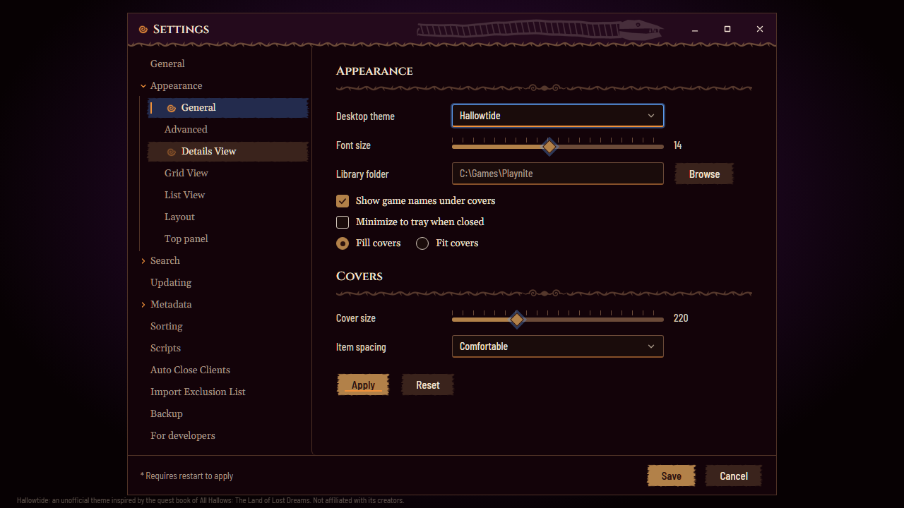

<!-- Generated by scripts/generate-readmes.mjs from info/*.yaml and git tags. Edit those, then re-run it; do not edit this file by hand. -->

# Hallowtide

**An inked storybook theme: parchment pages, rope frames, torn paper and lantern light, inspired by the quest book of All Hallows: The Land of Lost Dreams. Unofficial.**

_Not released yet._

## Screenshots

## About

Hallowtide turns Playnite into a quest book. A plum-black night carries the interface; the game page is an open book of
parchment pages with a hand-inked rope border and ink text, titles are carved caps with a thorn rule and spiral flourish
under them, and the Play button is a torn paper plate lit by a lantern with fireflies drifting up while you hover.
The rail has a red barcode bookmark and blue bookmark tabs, the settings list is a contents list with a turning spiral,
covers get an inked frame and a dropped wax pin on hover, tooltips are pinned notes, popups are the teal speech box.
Bundled fonts (Cinzel, Gelasio, Barlow Semi Condensed, Patrick Hand), no game assets.
Unofficial fan theme, not affiliated with or endorsed by the creators of All Hallows: The Land of Lost Dreams, Media Molecule or Sony.

## Install

1. **Inside Playnite:** open **Add-ons** from the main menu, browse or search for **Hallowtide**, and install it from there.
2. **Or from GitHub:** download the `.pthm` file from the release page (see Download above) and open it in **Windows** (double-click it or drag it onto Playnite).
3. Click **Install** when Playnite prompts you, then restart Playnite.
4. Pick the theme in **Settings → Appearance → General → Theme** (Desktop mode), then restart Playnite if it asks.

## Details

- **Type:** Theme (Desktop mode)
- **Latest release:** not released yet
- **Playnite theme API:** 2.9.0
- **Tags:** Dark, Desktop
- **Source:** [src/themes/Hallowtide](https://github.com/danitesler/playnite-extensions/tree/main/src/themes/Hallowtide)
- **Issues and suggestions:** [GitHub issues](https://github.com/danitesler/playnite-extensions/issues)

## Notices and licenses

- [LICENSE-Playnite.txt](info/LICENSE-Playnite.txt)
- [NOTICE-Hallowtide.txt](info/NOTICE-Hallowtide.txt)

---

[← All add-ons](../../../README.md)
