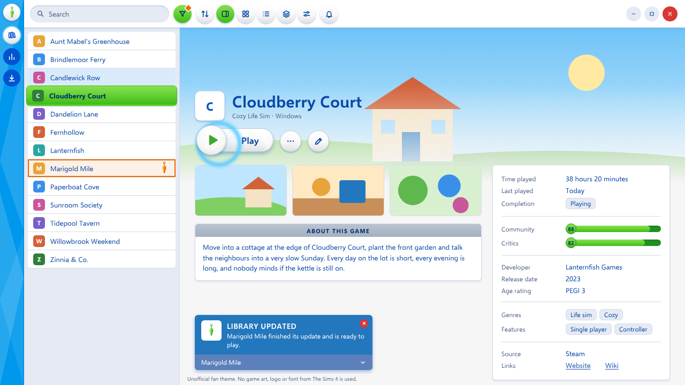
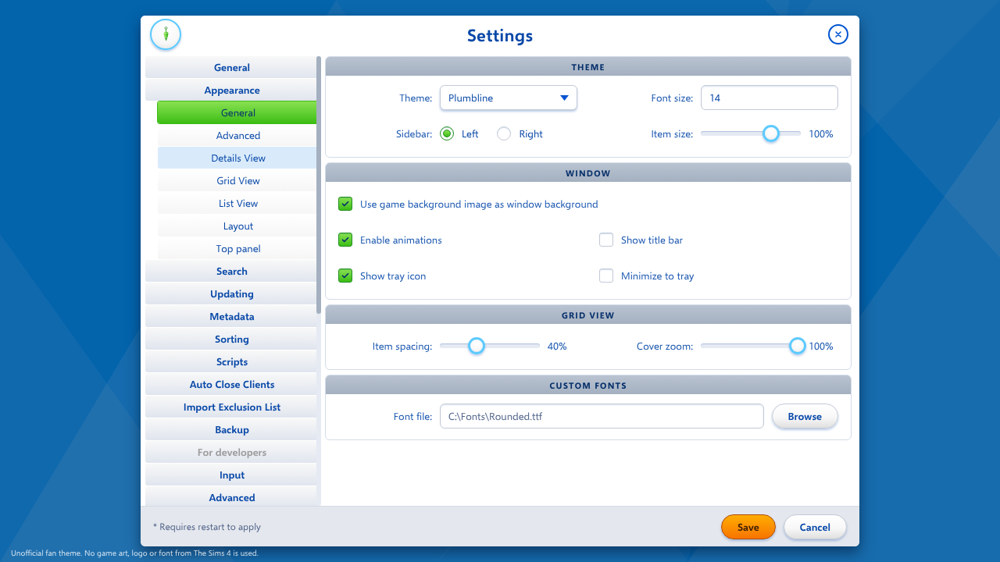

<!-- Generated by scripts/generate-readmes.mjs from info/*.yaml and git tags. Edit those, then re-run it; do not edit this file by hand. -->

# Plumbline

**Unofficial Sims 4-inspired light theme: a Sims-blue faceted rail with round disc buttons, white plates on a pale page, a big white Play disc with a green triangle that blooms and springs, green gloss selection, and an orange lozenge that bobs over the running game.**

_Not released yet._

## Screenshots

## About

Unofficial Sims 4-inspired light theme: a Sims-blue faceted rail with round disc buttons, white plates on a pale page, a big white Play disc with a green triangle that blooms and springs, green gloss selection, and an orange lozenge that bobs over the running game. Unofficial fan theme, not affiliated with or endorsed by Electronic Arts or Maxis.

## Install

1. **Inside Playnite:** open **Add-ons** from the main menu, browse or search for **Plumbline**, and install it from there.
2. **Or from GitHub:** download the `.pthm` file from the release page (see Download above) and open it in **Windows** (double-click it or drag it onto Playnite).
3. Click **Install** when Playnite prompts you, then restart Playnite.
4. Pick the theme in **Settings → Appearance → General → Theme** (Desktop mode), then restart Playnite if it asks.

## Details

- **Type:** Theme (Desktop mode)
- **Latest release:** not released yet
- **Playnite theme API:** 2.9.0
- **Tags:** Light, Desktop
- **Source:** [src/themes/Plumbline](https://github.com/danitesler/playnite-extensions/tree/main/src/themes/Plumbline)
- **Issues and suggestions:** [GitHub issues](https://github.com/danitesler/playnite-extensions/issues)

## Notices and licenses

- [LICENSE-Playnite.txt](info/LICENSE-Playnite.txt)
- [NOTICE-Plumbline.txt](info/NOTICE-Plumbline.txt)

---

[← All add-ons](../../../README.md)
