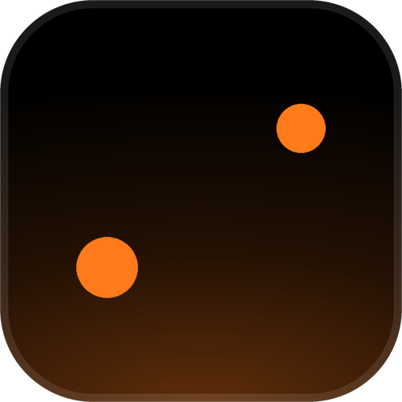
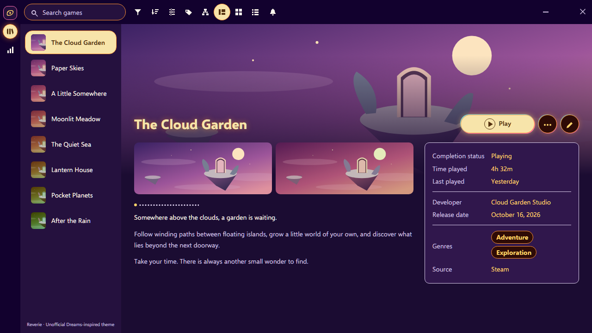
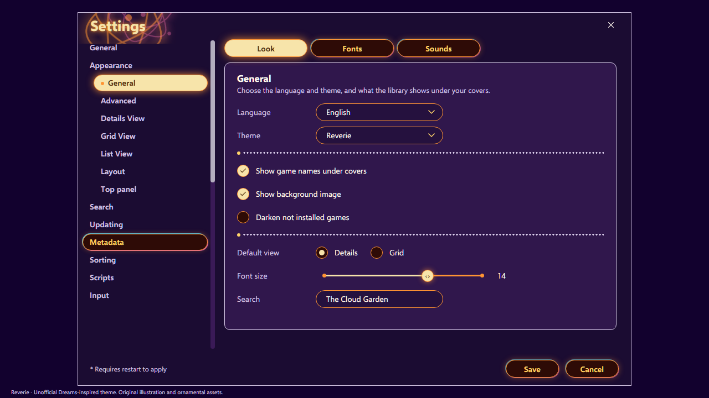

<!-- Generated by scripts/generate-readmes.mjs from info/*.yaml and git tags. Edit those, then re-run it; do not edit this file by hand. -->

# Reverie

**An unofficial Dreams-inspired theme with violet atmosphere, luminous gold controls and playful neon orbit accents.**

_Not released yet._

## Screenshots

## About

An unofficial Dreams-inspired theme with violet atmosphere, luminous gold controls and playful neon orbit accents.
Not affiliated with, endorsed by, or sponsored by Media Molecule or Sony Interactive Entertainment. All theme artwork is original.

## Install

1. **Inside Playnite:** open **Add-ons** from the main menu, browse or search for **Reverie**, and install it from there.
2. **Or from GitHub:** download the `.pthm` file from the release page (see Download above) and open it in **Windows** (double-click it or drag it onto Playnite).
3. Click **Install** when Playnite prompts you, then restart Playnite.
4. Pick the theme in **Settings → Appearance → General → Theme** (Desktop mode), then restart Playnite if it asks.

## Details

- **Type:** Theme (Desktop mode)
- **Latest release:** not released yet
- **Playnite theme API:** 2.10.0
- **Tags:** Dark, Desktop
- **Source:** [src/themes/Reverie](https://github.com/danitesler/playnite-extensions/tree/main/src/themes/Reverie)
- **Issues and suggestions:** [GitHub issues](https://github.com/danitesler/playnite-extensions/issues)

## Notices and licenses

- [LICENSE-Playnite.txt](info/LICENSE-Playnite.txt)
- [NOTICE-Reverie.txt](info/NOTICE-Reverie.txt)

---

[← All add-ons](../../../README.md)
