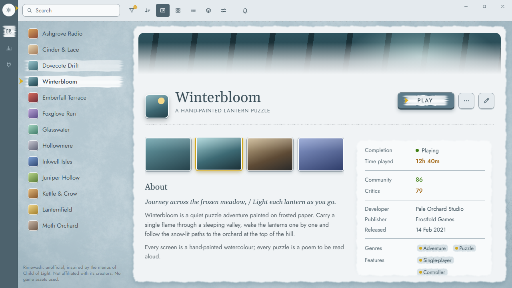
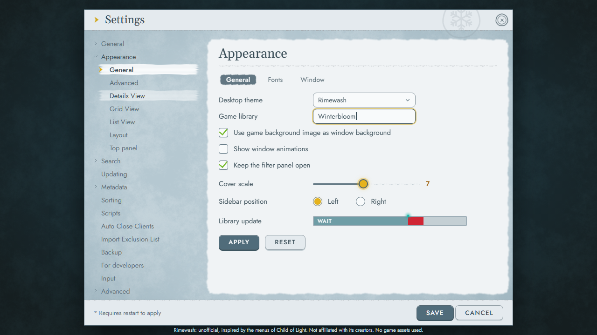

<!-- Generated by scripts/generate-readmes.mjs from info/*.yaml and git tags. Edit those, then re-run it; do not edit this file by hand. -->

# Rimewash

**A frosted watercolour paper theme with torn snow plates, a dry-brush swipe and a golden chevron cursor, inspired by Child of Light (unofficial, not affiliated).**

_Not released yet._

## Screenshots

## About

A light Playnite theme drawn like the menu screens of a painted fairy tale: a pale blue-grey watercolour wash, torn white snow plates on a soft shadow, slate slots and buttons, orange values and dotted pencil rules under serif titles. Whatever is selected gets a white dry-brush swipe and a golden chevron; Play draws the swipe across its slate plate and a teal wisp keeps the running game company.

Inspired by the menus of Child of Light. Unofficial fan theme: not affiliated with or endorsed by the game's developer or publisher. No game art, logo or font is used.

## Install

1. **Inside Playnite:** open **Add-ons** from the main menu, browse or search for **Rimewash**, and install it from there.
2. **Or from GitHub:** download the `.pthm` file from the release page (see Download above) and open it in **Windows** (double-click it or drag it onto Playnite).
3. Click **Install** when Playnite prompts you, then restart Playnite.
4. Pick the theme in **Settings → Appearance → General → Theme** (Desktop mode), then restart Playnite if it asks.

## Details

- **Type:** Theme (Desktop mode)
- **Latest release:** not released yet
- **Playnite theme API:** 2.9.0
- **Tags:** Light, Desktop
- **Source:** [src/themes/Rimewash](https://github.com/danitesler/playnite-extensions/tree/main/src/themes/Rimewash)
- **Issues and suggestions:** [GitHub issues](https://github.com/danitesler/playnite-extensions/issues)

## Notices and licenses

- [LICENSE-Playnite.txt](info/LICENSE-Playnite.txt)
- [NOTICE-Rimewash.txt](info/NOTICE-Rimewash.txt)

---

[← All add-ons](../../../README.md)
