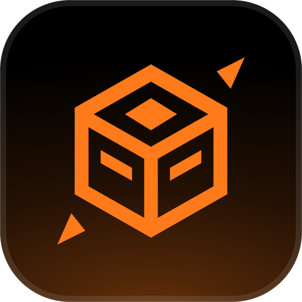
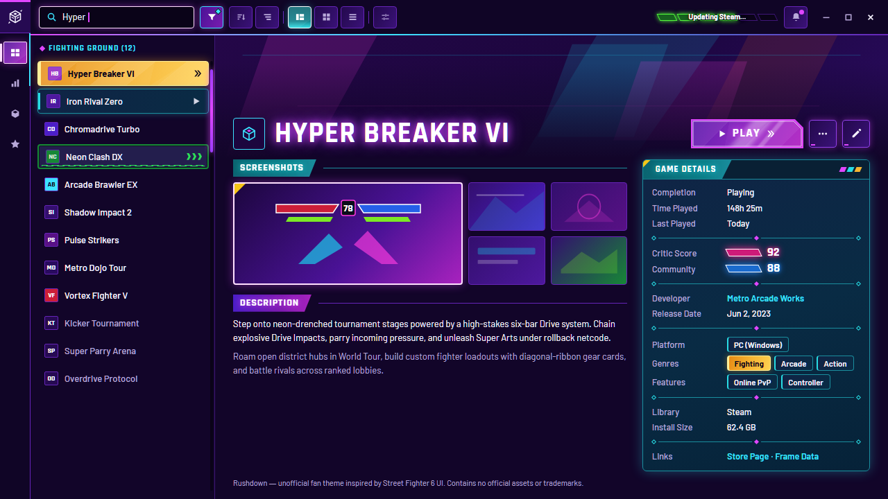
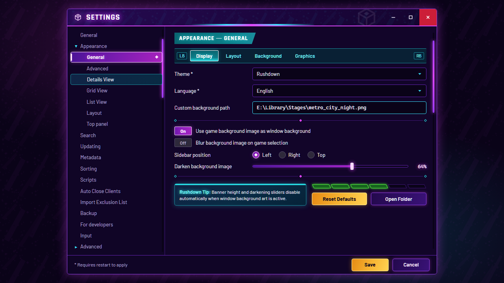

<!-- Generated by scripts/generate-readmes.mjs from info/*.yaml and git tags. Edit those, then re-run it; do not edit this file by hand. -->

# Rushdown

**Street Fighter 6 inspired dark theme fusing ultraviolet-magenta neon glows with World Tour Pause Mode aqua-teal glass, sunburst amber-gold highlights, 6-block Drive Gauge bars, and Super Art scores.**

_Not released yet._

## Screenshots

## About

Rushdown is a dark Playnite desktop theme blending Street Fighter 6's Fighting Ground / Shortcut Settings neon ultraviolet-magenta UI with World Tour Pause Mode translucent aqua-teal glass and sunburst amber-gold highlights.
Features deep ultraviolet-indigo shell chrome, glowing white titles and headings, a 45-degree chamfered violet-to-magenta Play CTA, Shortcut Settings On/Off switches, translucent Pause Mode aqua-teal glass metadata cards, tabs, group boxes, and diagonal-cut ribbons, sunburst amber-gold active game rows, hovered metadata chips, and Confirm buttons, 6-block slanted Drive Gauge progress bars, Super Art pink/blue Critic and Community score gauges, and Drive Gauge green running indicators.
Unofficial fan theme; not affiliated with or endorsed by Capcom Co., Ltd. Uses open Barlow and Rajdhani fonts (SIL OFL 1.1) and original procedural sprite textures and vector icons.

## Install

1. **Inside Playnite:** open **Add-ons** from the main menu, browse or search for **Rushdown**, and install it from there.
2. **Or from GitHub:** download the `.pthm` file from the release page (see Download above) and open it in **Windows** (double-click it or drag it onto Playnite).
3. Click **Install** when Playnite prompts you, then restart Playnite.
4. Pick the theme in **Settings → Appearance → General → Theme** (Desktop mode), then restart Playnite if it asks.

## Details

- **Type:** Theme (Desktop mode)
- **Latest release:** not released yet
- **Playnite theme API:** 2.9.0
- **Tags:** Dark, Desktop
- **Source:** [src/themes/Rushdown](https://github.com/danitesler/playnite-extensions/tree/main/src/themes/Rushdown)
- **Issues and suggestions:** [GitHub issues](https://github.com/danitesler/playnite-extensions/issues)

## Notices and licenses

- [LICENSE-Playnite.txt](info/LICENSE-Playnite.txt)
- [NOTICE-Rushdown.txt](info/NOTICE-Rushdown.txt)

---

[← All add-ons](../../../README.md)
