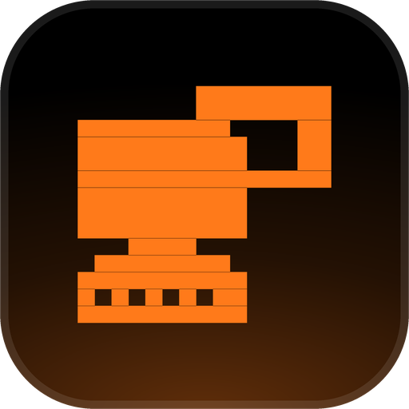
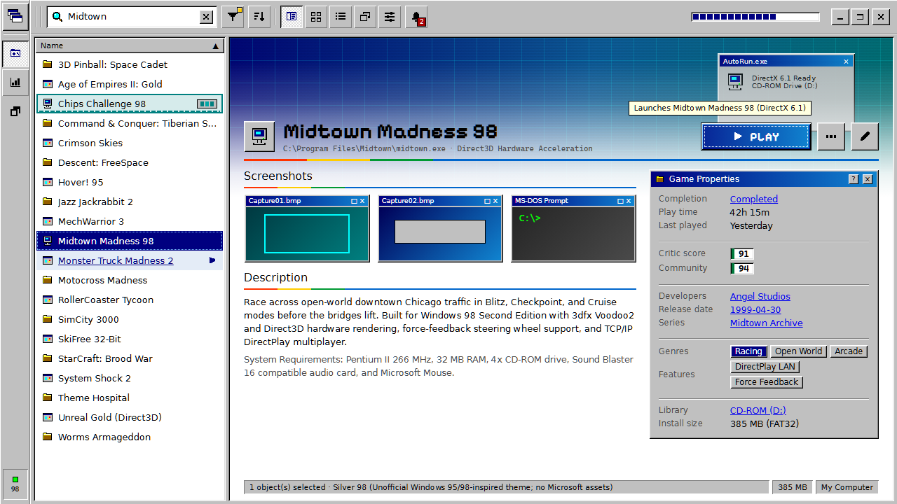
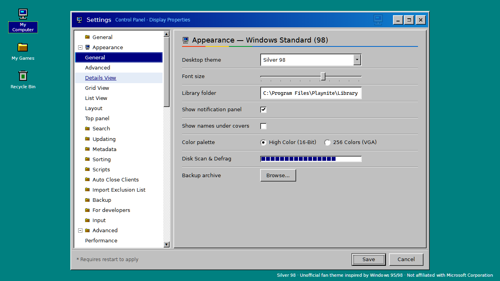

<!-- Generated by scripts/generate-readmes.mjs from info/*.yaml and git tags. Edit those, then re-run it; do not edit this file by hand. -->

# Silver 98

**Unofficial light retro desktop theme inspired by Microsoft Windows 95 and Windows 98 classic 3D silver chrome, navy title bars, Explorer 4.0 Web View, and 16-color VGA pixel icons.**

_Not released yet._

## Screenshots

## About

Silver 98 is a light Playnite Desktop theme inspired by the classic 3D silver window chrome (#C0C0C0), 2px raised and sunken bevels, active #000080 to #1084D0 title-bar gradients, sunken white client wells, Explorer 4.0 "View as Web Page" 4-color divider rules, and 16-color VGA pixel icons of Microsoft Windows 95 and Windows 98.

Features a classic Win98 Explorer rebar top toolbar and 44px silver quick-launch sidebar rail, 24 custom 16-color pixel-art context-menu icons with a vertical navy "Silver 98" branding banner strip, a Win32 Default Push Button Play CTA with navy-to-blue active title-bar gradient and 1px dotted inner focus frame, Windows 95/98 Desktop Teal (#008080) launching and running sweeps with segmented progress blocks and stepping pixel pips, dithered checkerboard scrollbar tracks, segmented navy block progress meters, a Windows 98 File Properties 3D dialog metadata card (supporting Left, Center, Stretch, and Right positions), light-theme window-background ink flipping, and an Explorer Program Manager dialog empty game page.

Unofficial community theme; not affiliated with or endorsed by Microsoft Corporation. Contains no official Microsoft logos, trademarks, or extracted operating system binaries.

## Install

1. **Inside Playnite:** open **Add-ons** from the main menu, browse or search for **Silver 98**, and install it from there.
2. **Or from GitHub:** download the `.pthm` file from the release page (see Download above) and open it in **Windows** (double-click it or drag it onto Playnite).
3. Click **Install** when Playnite prompts you, then restart Playnite.
4. Pick the theme in **Settings → Appearance → General → Theme** (Desktop mode), then restart Playnite if it asks.

## Details

- **Type:** Theme (Desktop mode)
- **Latest release:** not released yet
- **Playnite theme API:** 2.9.0
- **Tags:** Light, Retro, Pixel, Windows98, Desktop
- **Source:** [src/themes/Silver98](https://github.com/danitesler/playnite-extensions/tree/main/src/themes/Silver98)
- **Issues and suggestions:** [GitHub issues](https://github.com/danitesler/playnite-extensions/issues)

## Notices and licenses

- [LICENSE-Playnite.txt](info/LICENSE-Playnite.txt)
- [NOTICE-Silver98.txt](info/NOTICE-Silver98.txt)

---

[← All add-ons](../../../README.md)
