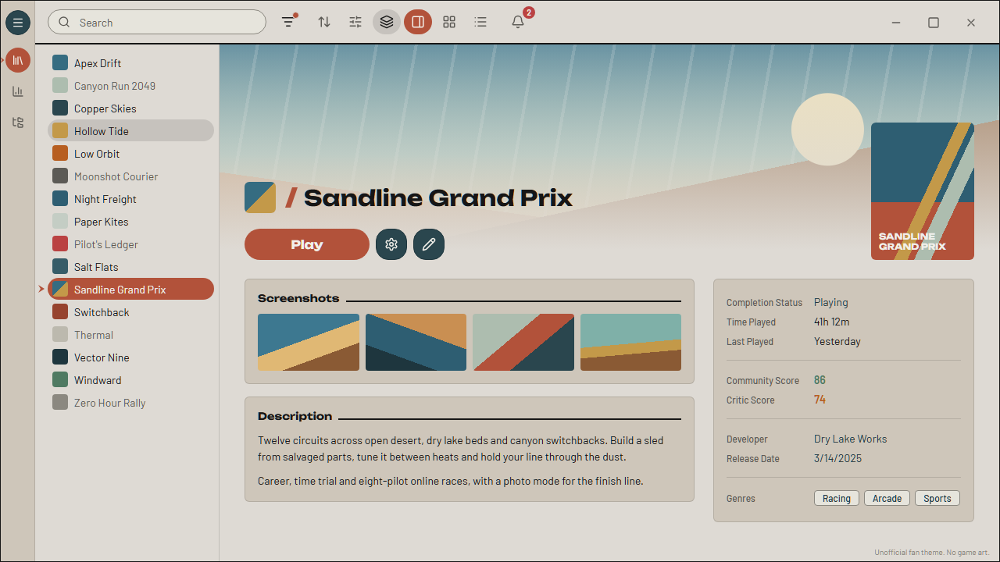
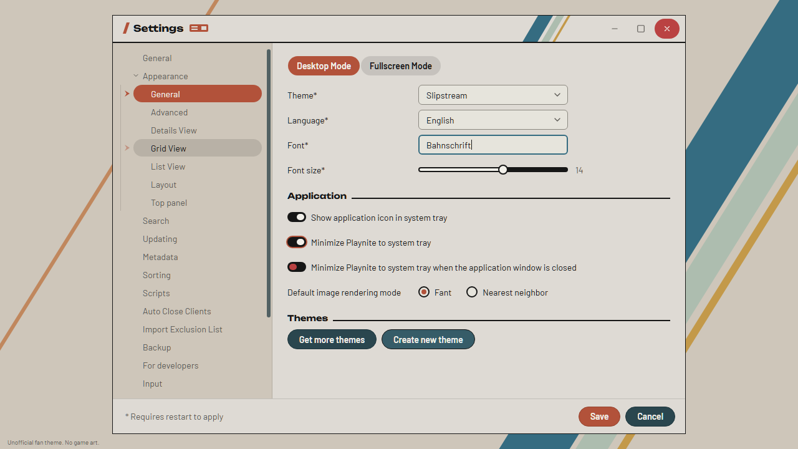

<!-- Generated by scripts/generate-readmes.mjs from info/*.yaml and git tags. Edit those, then re-run it; do not edit this file by hand. -->

# Slipstream

**Star Wars: Galactic Racer inspired (unofficial): a light theme of warm paper, ink type, vermilion selection pills, teal buttons and racing stripes.**

_Not released yet._

## Screenshots

## About

A light Playnite desktop theme inspired by the menus of Star Wars: Galactic Racer: a warm paper page, ink type and rules, vermilion pills for the selected tab and row, dark teal dialog pills, toggle switches, and blue, sage and mustard racing stripes. Unofficial and fan-made; not affiliated with, endorsed by or sponsored by Lucasfilm, Disney, or the game's developer or publisher. Contains no game art, logo or font.

## Install

1. **Inside Playnite:** open **Add-ons** from the main menu, browse or search for **Slipstream**, and install it from there.
2. **Or from GitHub:** download the `.pthm` file from the release page (see Download above) and open it in **Windows** (double-click it or drag it onto Playnite).
3. Click **Install** when Playnite prompts you, then restart Playnite.
4. Pick the theme in **Settings → Appearance → General → Theme** (Desktop mode), then restart Playnite if it asks.

## Details

- **Type:** Theme (Desktop mode)
- **Latest release:** not released yet
- **Playnite theme API:** 2.9.0
- **Tags:** Light, Desktop
- **Source:** [src/themes/Slipstream](https://github.com/danitesler/playnite-extensions/tree/main/src/themes/Slipstream)
- **Issues and suggestions:** [GitHub issues](https://github.com/danitesler/playnite-extensions/issues)

## Notices and licenses

- [LICENSE-Playnite.txt](info/LICENSE-Playnite.txt)
- [LICENSE-lucide.txt](info/LICENSE-lucide.txt)
- [LICENSE-unbounded.txt](info/LICENSE-unbounded.txt)
- [NOTICE-Slipstream.txt](info/NOTICE-Slipstream.txt)

---

[← All add-ons](../../../README.md)
