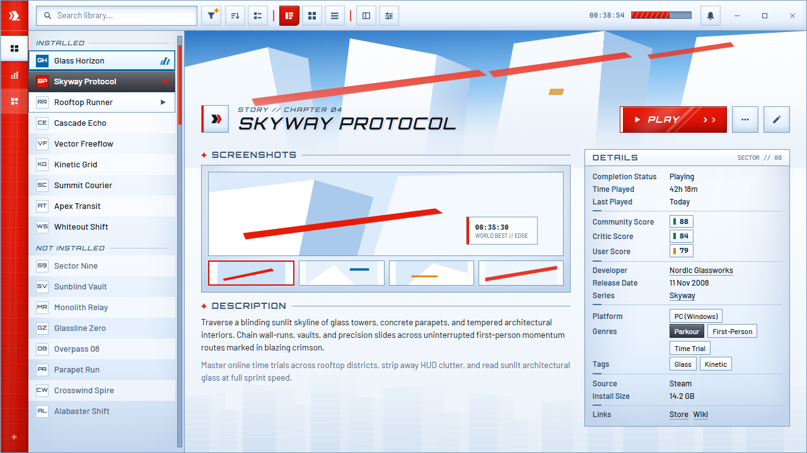
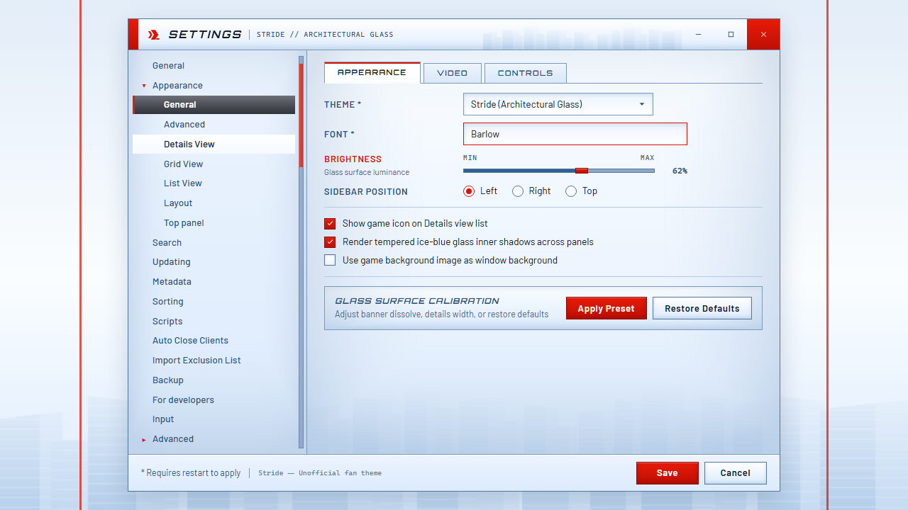

<!-- Generated by scripts/generate-readmes.mjs from info/*.yaml and git tags. Edit those, then re-run it; do not edit this file by hand. -->

# Stride

**Unofficial stark light architectural glass theme inspired by Mirror's Edge (2008) and Mirror's Edge Catalyst — tempered ice-blue glass panels with velvety inner shadows, blazing red vertical pillar, glossy charcoal selection bars, and rooftop skyline.**

_Not released yet._

## Screenshots

## About

Stride is a stark light Playnite Desktop theme inspired by the sunlit architectural glass UI of Mirror's Edge (2008) and Mirror's Edge Catalyst.

Features a 44px blazing Mirror's Edge Red vertical sidebar pillar with inverted pure-white active slabs, a 48px frosted ice-blue glass top bar with recessed search well and Runner Bag Signal Amber '+' filter pip, tempered ice-blue frosted glass panels with velvety 4-edge cool-blue inner shadows and diagonal window sheen, glossy charcoal-glass selection bars with chunky blazing red '+' markers, blazing red scrollbar and slider thumbs on translucent steel-blue glass tracks, raised snow-white vs recessed ice-blue glass folder tabs, Rooftop Sky Cerulean launching and running sweeps, tempered glass popup menus led by a 4px red pillar, crisp cover tiles with 50x50 crimson/glass action buttons, a Tempered Glass Metadata Dossier (supporting Left, Center, Stretch, and Right positions), light-theme window-background ink flipping, and a sunlit architectural skyline empty game page.

Unofficial fan theme; not affiliated with or endorsed by Electronic Arts Inc. or EA Digital Illusions CE AB (DICE). Contains no official game assets, logos, trademarks, or proprietary fonts.

## Install

1. **Inside Playnite:** open **Add-ons** from the main menu, browse or search for **Stride**, and install it from there.
2. **Or from GitHub:** download the `.pthm` file from the release page (see Download above) and open it in **Windows** (double-click it or drag it onto Playnite).
3. Click **Install** when Playnite prompts you, then restart Playnite.
4. Pick the theme in **Settings → Appearance → General → Theme** (Desktop mode), then restart Playnite if it asks.

## Details

- **Type:** Theme (Desktop mode)
- **Latest release:** not released yet
- **Playnite theme API:** 2.9.0
- **Tags:** Light, Desktop
- **Source:** [src/themes/Stride](https://github.com/danitesler/playnite-extensions/tree/main/src/themes/Stride)
- **Issues and suggestions:** [GitHub issues](https://github.com/danitesler/playnite-extensions/issues)

## Notices and licenses

- [LICENSE-Playnite.txt](info/LICENSE-Playnite.txt)
- [NOTICE-Stride.txt](info/NOTICE-Stride.txt)

---

[← All add-ons](../../../README.md)
