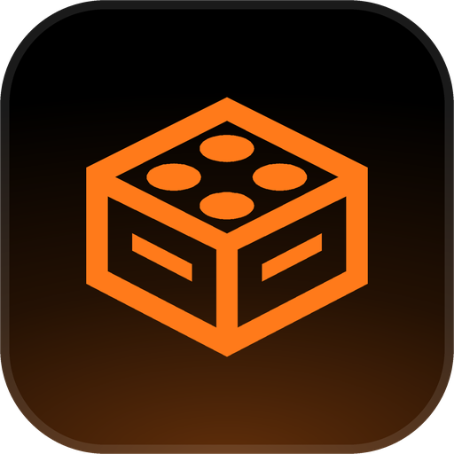
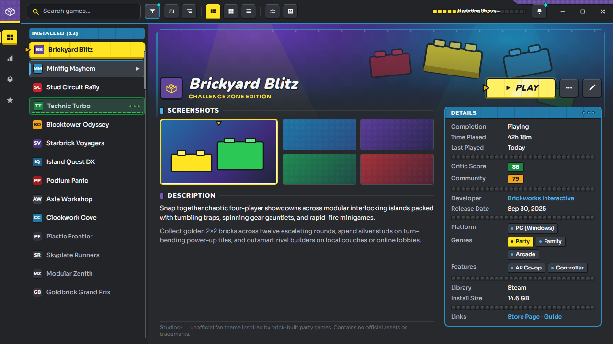
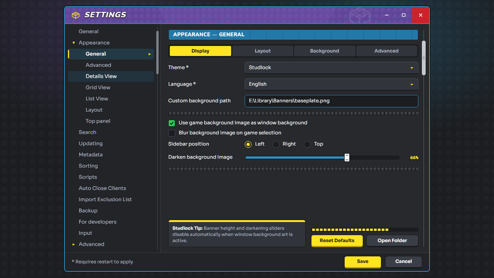

<!-- Generated by scripts/generate-readmes.mjs from info/*.yaml and git tags. Edit those, then re-run it; do not edit this file by hand. -->

# Studlock

**Unofficial fan theme inspired by the molded charcoal baseplate, chamfered cerulean brick frames, studded violet header plaques, canary yellow focus bars, and Technic axle controls of LEGO Party!**

_Not released yet._

## Screenshots

## About

Studlock is a dark Playnite Desktop theme inspired by the molded charcoal ABS baseplate, studded violet header plaques, chamfered cerulean brick frames, canary yellow brick-seamed focus bars, and Technic axle controls of LEGO Party!

Features a brick-seamed Canary Yellow Play slab with glossy ABS plastic sheen sweep and sliding golden triangle cursor, Canary Yellow brick-seamed library row selection, Wardrobe-style yellow selected cover frames with floating top downward cursors and 50x50 molded brick hover buttons, chamfered Cerulean Brick popup menus and dropdowns crowned by a studded violet strip with molded circular stud-row dividers and Brick Red Exit rows, Technic axle scrollbars and notched white collar sliders, segmented vertical-brick progress bars, a Cerulean-framed metadata dossier with molded stud-row group breaks (supporting Left, Center, Stretch, and Right positions), Equipped Brick Green launching and running indicators with segmented sweeps and 3 bouncing circular studs, a Wardrobe Aqua active filter badge, a studded Stage Violet Settings title band, and a Golden 2x2 Brick empty game page.

Unofficial fan theme; not affiliated with or endorsed by The LEGO Group, SMG Studio, or Fictions. Contains no official game assets, logos, trademarks, or proprietary fonts.

## Install

1. **Inside Playnite:** open **Add-ons** from the main menu, browse or search for **Studlock**, and install it from there.
2. **Or from GitHub:** download the `.pthm` file from the release page (see Download above) and open it in **Windows** (double-click it or drag it onto Playnite).
3. Click **Install** when Playnite prompts you, then restart Playnite.
4. Pick the theme in **Settings → Appearance → General → Theme** (Desktop mode), then restart Playnite if it asks.

## Details

- **Type:** Theme (Desktop mode)
- **Latest release:** not released yet
- **Playnite theme API:** 2.9.0
- **Tags:** Dark, Desktop
- **Source:** [src/themes/Studlock](https://github.com/danitesler/playnite-extensions/tree/main/src/themes/Studlock)
- **Issues and suggestions:** [GitHub issues](https://github.com/danitesler/playnite-extensions/issues)

## Notices and licenses

- [LICENSE-Playnite.txt](info/LICENSE-Playnite.txt)
- [NOTICE-Studlock.txt](info/NOTICE-Studlock.txt)

---

[← All add-ons](../../../README.md)
