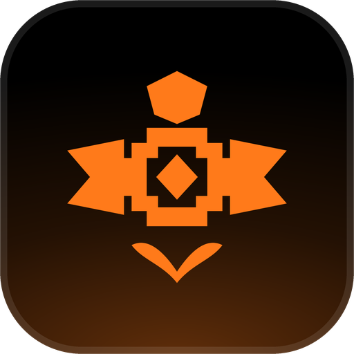
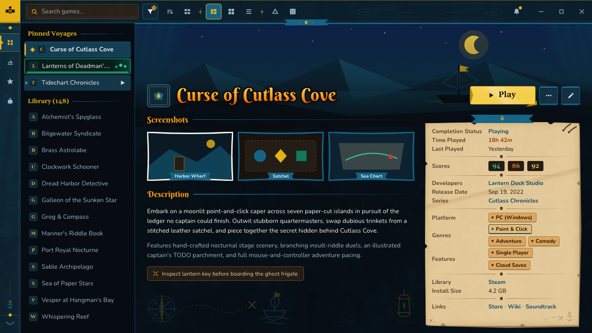
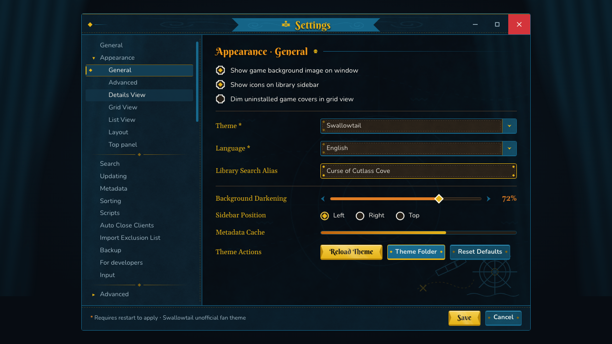

<!-- Generated by scripts/generate-readmes.mjs from info/*.yaml and git tags. Edit those, then re-run it; do not edit this file by hand. -->

# Swallowtail

**Unofficial fan-made dark Playnite desktop theme inspired by Return to Monkey Island's nocturnal Caribbean theater menus, swallowtail ribbons, notched-octagon controls, and hand-cut frames.**

_Not released yet._

## Screenshots

## About

Swallowtail is an unofficial, fan-made dark desktop theme for Playnite inspired by the nocturnal Caribbean theater menus and storybook craft of Return to Monkey Island (2022).

Highlights:
- Nocturnal harbor stage shell with subtle theater-curtain drapes, curled Pirate Gold main-menu crest tile, stitched espresso-leather search well, and golden skull-centered seam.
- Curled Pirate Gold Play ribbon with lantern sheen sweep, Ghost-Ship Emerald launching comet & drifting lantern-wisp running indicators, and equal square More/Edit actions.
- Pinched concave Save-slot cover frames, 50x50 notched-octagon cover hover medallions, torn-edge aged parchment Harbor Dossier metadata sheet with leather-cord stitches and wooden keycap tags (supporting Left, Center/Stretch, and Right positions), and curtained empty-selection stage.
- Authentic white 8-corner notched-octagon checkboxes with gold diamond cores, Deep Aqua wedge-capped sliders with Burnt Bronze tracks, and unified swallowtail-crowned popup menus & Settings chrome.

Unofficial fan theme: not affiliated with or endorsed by Terrible Toybox, Devolver Digital, or Lucasfilm Ltd. No proprietary game assets, logos, or trademarks are included.

## Install

1. **Inside Playnite:** open **Add-ons** from the main menu, browse or search for **Swallowtail**, and install it from there.
2. **Or from GitHub:** download the `.pthm` file from the release page (see Download above) and open it in **Windows** (double-click it or drag it onto Playnite).
3. Click **Install** when Playnite prompts you, then restart Playnite.
4. Pick the theme in **Settings → Appearance → General → Theme** (Desktop mode), then restart Playnite if it asks.

## Details

- **Type:** Theme (Desktop mode)
- **Latest release:** not released yet
- **Playnite theme API:** 2.9.0
- **Tags:** Dark, Desktop
- **Source:** [src/themes/Swallowtail](https://github.com/danitesler/playnite-extensions/tree/main/src/themes/Swallowtail)
- **Issues and suggestions:** [GitHub issues](https://github.com/danitesler/playnite-extensions/issues)

## Notices and licenses

- [LICENSE-Playnite.txt](info/LICENSE-Playnite.txt)
- [NOTICE-Swallowtail.txt](info/NOTICE-Swallowtail.txt)

---

[← All add-ons](../../../README.md)
