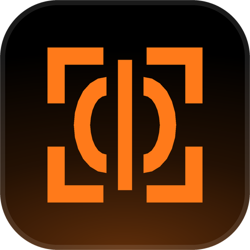
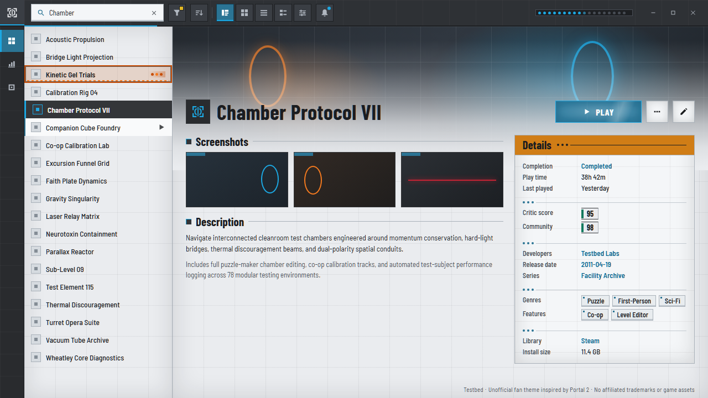
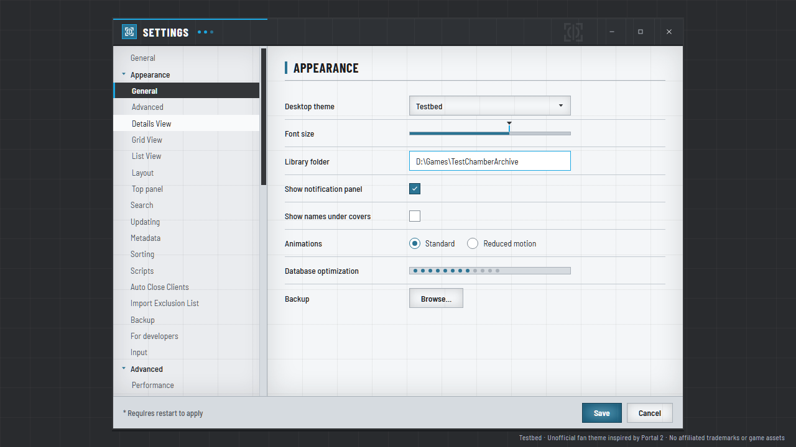

<!-- Generated by scripts/generate-readmes.mjs from info/*.yaml and git tags. Edit those, then re-run it; do not edit this file by hand. -->

# Testbed

**Unofficial light cleanroom theme inspired by the modular test-chamber panels, Portal Blue & Propulsion Orange polarity, and Aperture Charcoal bars of Portal 2.**

_Not released yet._

## Screenshots

## About

Testbed is a light Playnite Desktop theme inspired by the cleanroom modular test-chamber architecture, stepped aluminum tiles, antline indicator dots, and Portal Blue / Propulsion Orange polarity palette of Portal 2.

Features a 44px dark carbon modular rail and 48px carbon top bar paired with warm matte cleanroom wall panels (#E2E5E8 / #F2F4F6), a Portal Blue architectural Play slab with 9-slice rim bloom, diagonal portal sheen sweep, and closing corner brackets, Propulsion Orange launching and running sweeps with staggered telemetry beacons, stepped-tab charcoal-and-aluminum popup menus with monospace key-prompt caps and Thermal Crimson Exit confirmation, cleanroom cover tiles with 50x50 Portal Blue/Charcoal action buttons, an antline-segmented top-bar progress meter, a stepped-tab modular metadata dossier (supporting Left, Center, Stretch, and Right positions), light-theme window-background ink flipping, and a breathing chamber-standby empty game page.

Unofficial fan theme; not affiliated with or endorsed by Valve Corporation. Contains no official game assets, logos, trademarks, or proprietary fonts.

## Install

1. **Inside Playnite:** open **Add-ons** from the main menu, browse or search for **Testbed**, and install it from there.
2. **Or from GitHub:** download the `.pthm` file from the release page (see Download above) and open it in **Windows** (double-click it or drag it onto Playnite).
3. Click **Install** when Playnite prompts you, then restart Playnite.
4. Pick the theme in **Settings → Appearance → General → Theme** (Desktop mode), then restart Playnite if it asks.

## Details

- **Type:** Theme (Desktop mode)
- **Latest release:** not released yet
- **Playnite theme API:** 2.9.0
- **Tags:** Light, Desktop
- **Source:** [src/themes/Testbed](https://github.com/danitesler/playnite-extensions/tree/main/src/themes/Testbed)
- **Issues and suggestions:** [GitHub issues](https://github.com/danitesler/playnite-extensions/issues)

## Notices and licenses

- [LICENSE-Playnite.txt](info/LICENSE-Playnite.txt)
- [NOTICE-Testbed.txt](info/NOTICE-Testbed.txt)

---

[← All add-ons](../../../README.md)
