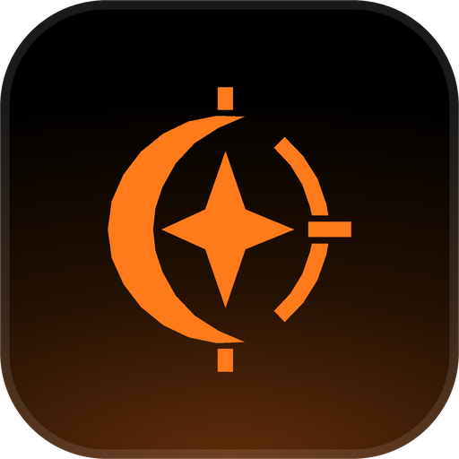
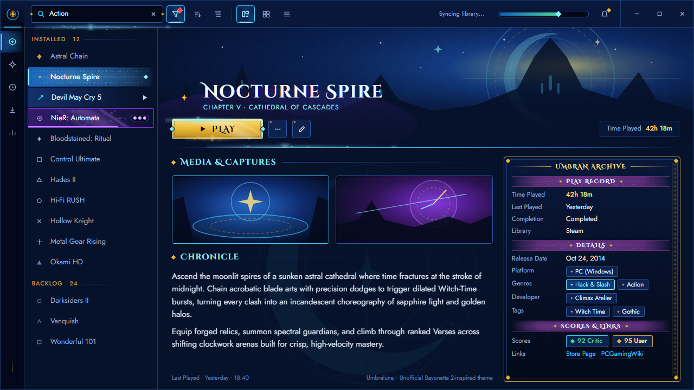
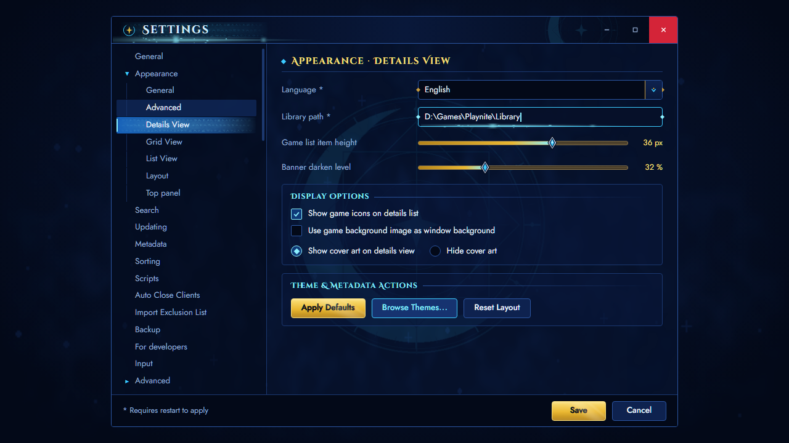

<!-- Generated by scripts/generate-readmes.mjs from info/*.yaml and git tags. Edit those, then re-run it; do not edit this file by hand. -->

# Umbralune

**Nocturnal sapphire, moon-cyan, and solar gold desktop theme inspired by Bayonetta 2.**

_Not released yet._

## Screenshots

## About

Umbralune is an unofficial fan-made Playnite desktop theme inspired by the nocturnal sapphire,
moon-cyan, solar gold, and Witch-Time amethyst visual language of Bayonetta 2.

Features an animated Umbran Crescent Watch main-menu emblem, glowing cyan rune-beam selection,
Solar Halo Gold Play command with optical flare hover, Chapter V sapphire-and-gold tarot
metadata dossier with violet rune ribbons, silver-chrome diamond-gem sliders, custom 24-icon
menu set, and a Witch-Time Amethyst 3-orb running game indicator.

Unofficial fan work, not affiliated with or endorsed by PlatinumGames, SEGA, or Nintendo.

## Install

1. **Inside Playnite:** open **Add-ons** from the main menu, browse or search for **Umbralune**, and install it from there.
2. **Or from GitHub:** download the `.pthm` file from the release page (see Download above) and open it in **Windows** (double-click it or drag it onto Playnite).
3. Click **Install** when Playnite prompts you, then restart Playnite.
4. Pick the theme in **Settings → Appearance → General → Theme** (Desktop mode), then restart Playnite if it asks.

## Details

- **Type:** Theme (Desktop mode)
- **Latest release:** not released yet
- **Playnite theme API:** 2.9.0
- **Tags:** Dark, Desktop, Blue, Gold, Gaming
- **Source:** [src/themes/Umbralune](https://github.com/danitesler/playnite-extensions/tree/main/src/themes/Umbralune)
- **Issues and suggestions:** [GitHub issues](https://github.com/danitesler/playnite-extensions/issues)

## Notices and licenses

- [LICENSE-Playnite.txt](info/LICENSE-Playnite.txt)
- [NOTICE-Umbralune.txt](info/NOTICE-Umbralune.txt)

---

[← All add-ons](../../../README.md)
