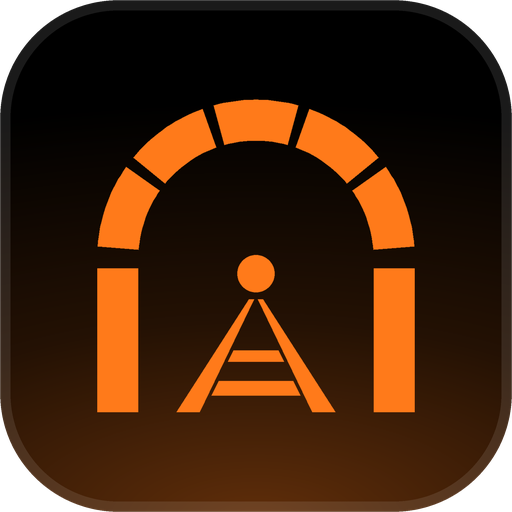
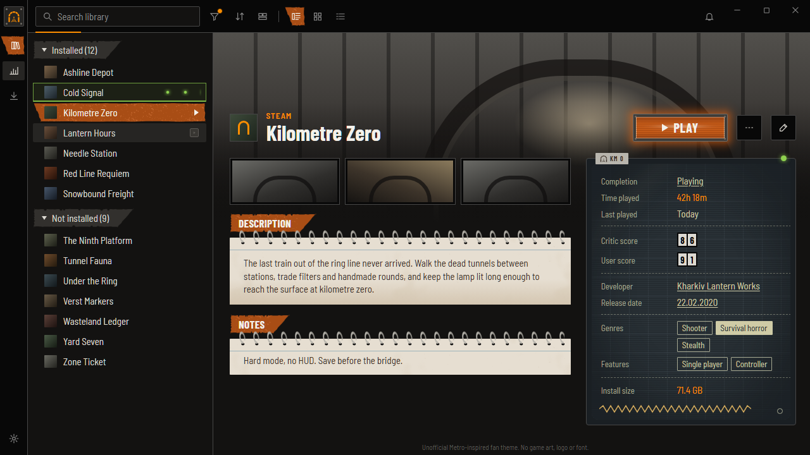
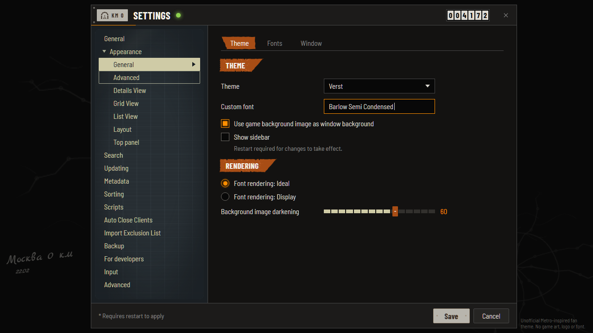

<!-- Generated by scripts/generate-readmes.mjs from info/*.yaml and git tags. Edit those, then re-run it; do not edit this file by hand. -->

# Verst

**A dark tunnel-machinery theme: burnt-orange flags, an oscilloscope for game details, a spiral field notebook and a glowing console display for Play, inspired by Metro Exodus and Metro: Last Light (unofficial, not affiliated).**

_Not released yet._

## Screenshots

## About

A dark Playnite theme built like the instruments of a post-war metro: an iron shell, a burnt-orange flag with a slanted tail on whatever is selected, torn orange banners over each section, and the game's details on an oscilloscope screen with a graticule, phosphor text, odometer scores and a trace along its foot. Descriptions and notes sit on a spiral-bound field notebook. Play is a glowing orange console display that flickers up, blooms and dips its power when pressed; a running game shows a chain of green tunnel lamps passing by. Settings use the oscilloscope for the section list and a riveted title band with a stencil plate, a green lamp and an odometer.

Inspired by the menus of Metro Exodus and Metro: Last Light Redux. Unofficial fan theme: not affiliated with or endorsed by the games' developer or publisher. No game art, logo or font is used.

## Install

1. **Inside Playnite:** open **Add-ons** from the main menu, browse or search for **Verst**, and install it from there.
2. **Or from GitHub:** download the `.pthm` file from the release page (see Download above) and open it in **Windows** (double-click it or drag it onto Playnite).
3. Click **Install** when Playnite prompts you, then restart Playnite.
4. Pick the theme in **Settings → Appearance → General → Theme** (Desktop mode), then restart Playnite if it asks.

## Details

- **Type:** Theme (Desktop mode)
- **Latest release:** not released yet
- **Playnite theme API:** 2.9.0
- **Tags:** Dark, Desktop
- **Source:** [src/themes/Verst](https://github.com/danitesler/playnite-extensions/tree/main/src/themes/Verst)
- **Issues and suggestions:** [GitHub issues](https://github.com/danitesler/playnite-extensions/issues)

## Notices and licenses

- [LICENSE-Playnite.txt](info/LICENSE-Playnite.txt)
- [NOTICE-Verst.txt](info/NOTICE-Verst.txt)

---

[← All add-ons](../../../README.md)
