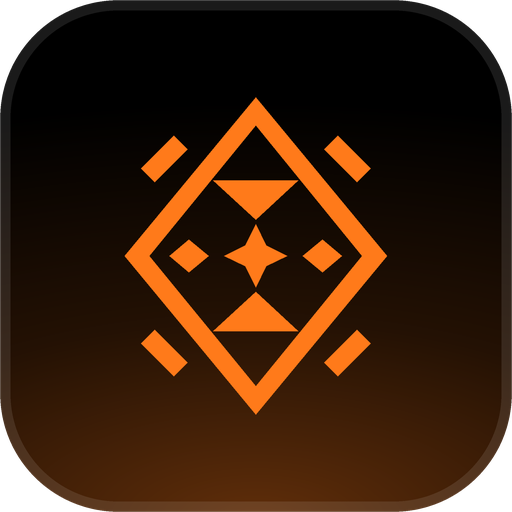
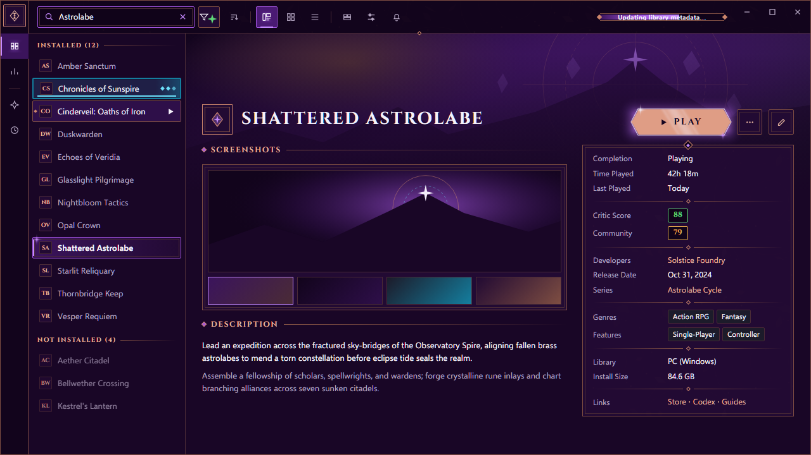
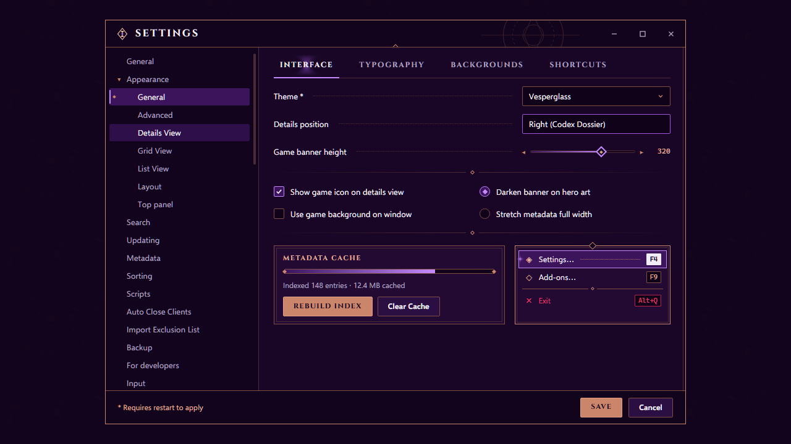

<!-- Generated by scripts/generate-readmes.mjs from info/*.yaml and git tags. Edit those, then re-run it; do not edit this file by hand. -->

# Vesperglass

**Unofficial fan theme inspired by the deep plum twilight glass, burnished rose-copper astrolabe framing, and electric amethyst star flares of Dragon Age: The Veilguard.**

_Not released yet._

## Screenshots

## About

Vesperglass is a dark Playnite Desktop theme inspired by the deep aubergine-plum glass, burnished rose-copper architectural hairlines, electric amethyst star flares, and lyrium crystal accents of Dragon Age: The Veilguard.

Features a burnished rose-copper pointed-hexagonal Play plaque with 9-slice violet-copper bloom and crystal sheen, Load/Save-inspired double-bordered library rows with 4-point star flares, Codex-framed cover tiles with faceted 52x52 medallions, twin-triangle hourglass active tab markers, rotated-diamond sliders, copper-diamond end-capped progress bars, Lyrium Frost cyan launching and running indicators with 3 cascading diamond rune sockets, Vitality Emerald 4-point active filter stars, double-hairline astrolabe popup menus with inverting alabaster keycap shortcuts, and a breathing astrolabe empty game page.

Unofficial fan theme; not affiliated with or endorsed by Electronic Arts Inc. or BioWare. Contains no official game assets, logos, or proprietary fonts.

## Install

1. **Inside Playnite:** open **Add-ons** from the main menu, browse or search for **Vesperglass**, and install it from there.
2. **Or from GitHub:** download the `.pthm` file from the release page (see Download above) and open it in **Windows** (double-click it or drag it onto Playnite).
3. Click **Install** when Playnite prompts you, then restart Playnite.
4. Pick the theme in **Settings → Appearance → General → Theme** (Desktop mode), then restart Playnite if it asks.

## Details

- **Type:** Theme (Desktop mode)
- **Latest release:** not released yet
- **Playnite theme API:** 2.9.0
- **Tags:** Dark, Desktop
- **Source:** [src/themes/Vesperglass](https://github.com/danitesler/playnite-extensions/tree/main/src/themes/Vesperglass)
- **Issues and suggestions:** [GitHub issues](https://github.com/danitesler/playnite-extensions/issues)

## Notices and licenses

- [LICENSE-Playnite.txt](info/LICENSE-Playnite.txt)
- [NOTICE-Vesperglass.txt](info/NOTICE-Vesperglass.txt)

---

[← All add-ons](../../../README.md)
