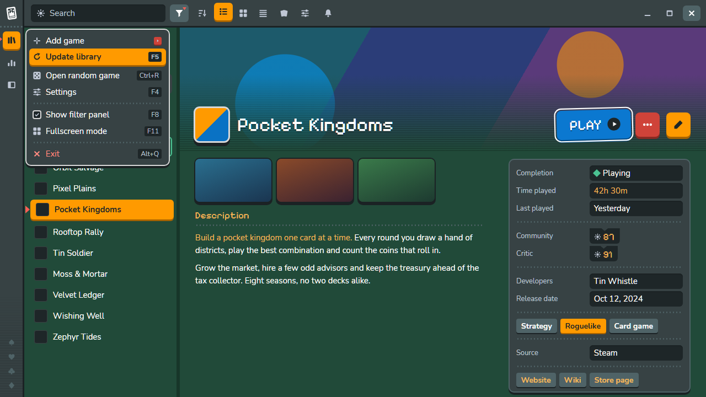
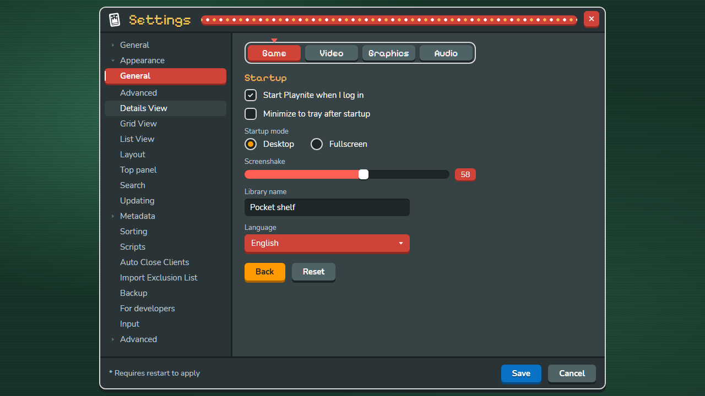

<!-- Generated by scripts/generate-readmes.mjs from info/*.yaml and git tags. Edit those, then re-run it; do not edit this file by hand. -->

# Wildhand

**Unofficial Balatro-inspired theme: slate HUD panels on green felt, ledged blue, red and orange plates.**

_Not released yet._

## Screenshots

## About

An unofficial, fan-made Playnite desktop theme inspired by the interface of Balatro. Not affiliated with or endorsed by the game's creators or publisher.

Slate run-HUD panels and recessed value wells sit on green felt. Every plate is a flat face over a hard ledge: a blue Play Hand button that rocks on hover, red tabs and close squares, orange selection plates with ink text, price-tag scores, dotted Cash Out leaders and a marquee-lit Settings title band. Selected rows and covers rise like a chosen card; a running game turns green with three stepping dots.

Nunito and Pixelify Sans are bundled (SIL Open Font License). No game art, logo, card faces or fonts are included.

## Install

1. **Inside Playnite:** open **Add-ons** from the main menu, browse or search for **Wildhand**, and install it from there.
2. **Or from GitHub:** download the `.pthm` file from the release page (see Download above) and open it in **Windows** (double-click it or drag it onto Playnite).
3. Click **Install** when Playnite prompts you, then restart Playnite.
4. Pick the theme in **Settings → Appearance → General → Theme** (Desktop mode), then restart Playnite if it asks.

## Details

- **Type:** Theme (Desktop mode)
- **Latest release:** not released yet
- **Playnite theme API:** 2.9.0
- **Tags:** Dark, Desktop, Gaming, Green
- **Source:** [src/themes/Wildhand](https://github.com/danitesler/playnite-extensions/tree/main/src/themes/Wildhand)
- **Issues and suggestions:** [GitHub issues](https://github.com/danitesler/playnite-extensions/issues)

## Notices and licenses

- [LICENSE-Playnite.txt](info/LICENSE-Playnite.txt)
- [NOTICE-Wildhand.txt](info/NOTICE-Wildhand.txt)

---

[← All add-ons](../../../README.md)
