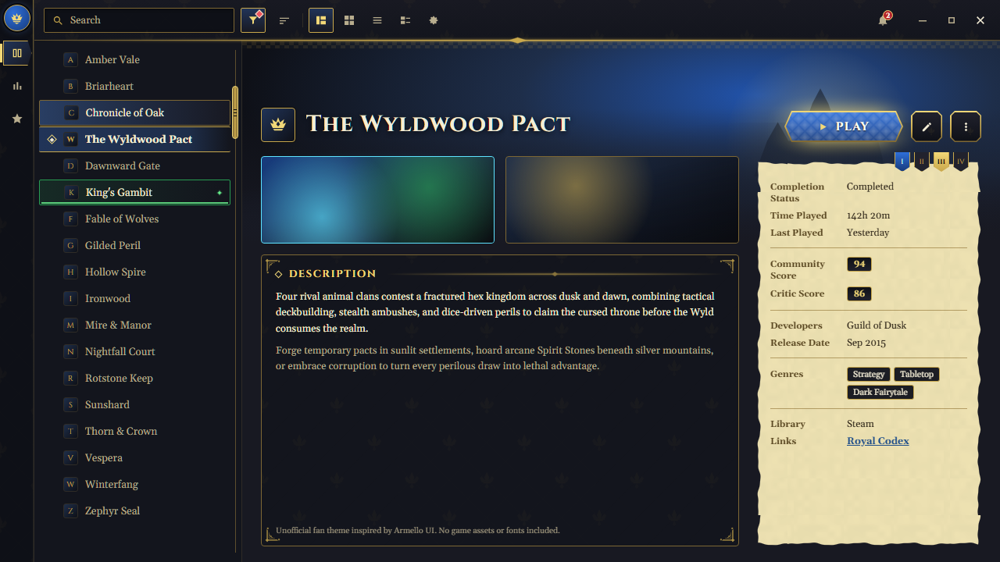
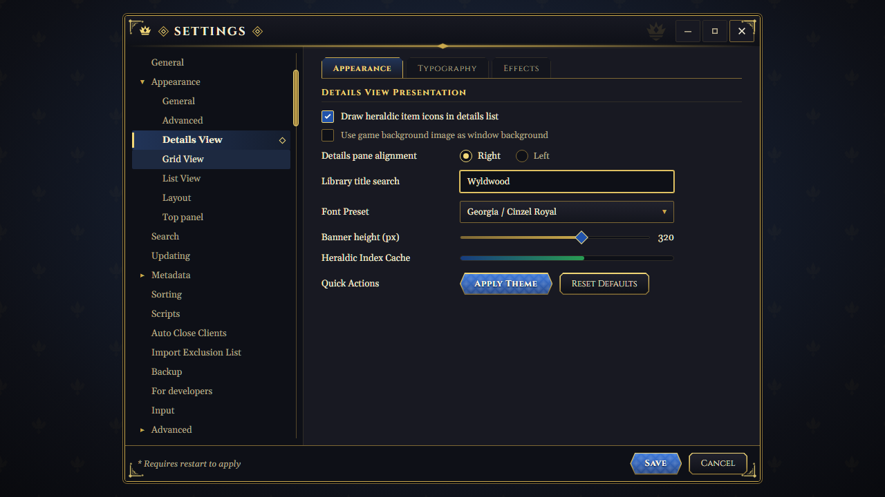

<!-- Generated by scripts/generate-readmes.mjs from info/*.yaml and git tags. Edit those, then re-run it; do not edit this file by hand. -->

# Wyldcrown

**A heraldic storybook tabletop theme: obsidian damask chrome, diamond-quilted sapphire Play medallions, and a deckled parchment Character Tome inspired by Armello. Unofficial.**

_Not released yet._

## Screenshots

## About

Wyldcrown turns Playnite into a heraldic tabletop court inspired by Armello UI. Obsidian damask panels (#0e1017–#181922)
and twilight indigo wash frame every screen with burnished gold rims (#c9a84c / #f2d878), four-corner filigree Flourishes,
and faceted diamond-seam dividers.

The hero Play CTA is a hexagonal, diamond-quilted Royal Sapphire medallion lit by a golden crown bloom; installed and
uninstalled covers on grid hover sprout staggered sapphire and iron medallions ringed by Cerulean Spirit luminescence;
launching and running games sweep Wyld Emerald aura, tracking fills, and a rotating Wyld Star emblem across rows, tiles,
and the Play button (revealing Cancel on self-hover). Game details pair dark editorial description bands with a deckled
parchment Character Tome metadata folio pinned by heraldic clan pennants and dark iron tag chips.

Bundled static Cinzel display capitals (SIL OFL 1.1) paired with Georgia serif; zero game artwork, logos, or audio.
Unofficial fan theme, not affiliated with or endorsed by League of Geeks or Armello.

## Install

1. **Inside Playnite:** open **Add-ons** from the main menu, browse or search for **Wyldcrown**, and install it from there.
2. **Or from GitHub:** download the `.pthm` file from the release page (see Download above) and open it in **Windows** (double-click it or drag it onto Playnite).
3. Click **Install** when Playnite prompts you, then restart Playnite.
4. Pick the theme in **Settings → Appearance → General → Theme** (Desktop mode), then restart Playnite if it asks.

## Details

- **Type:** Theme (Desktop mode)
- **Latest release:** not released yet
- **Playnite theme API:** 2.9.0
- **Tags:** Dark, Desktop
- **Source:** [src/themes/Wyldcrown](https://github.com/danitesler/playnite-extensions/tree/main/src/themes/Wyldcrown)
- **Issues and suggestions:** [GitHub issues](https://github.com/danitesler/playnite-extensions/issues)

## Notices and licenses

- [LICENSE-Playnite.txt](info/LICENSE-Playnite.txt)
- [NOTICE-Wyldcrown.txt](info/NOTICE-Wyldcrown.txt)

---

[← All add-ons](../../../README.md)
